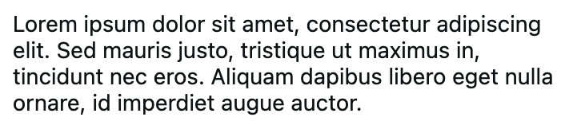
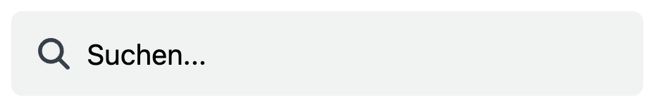
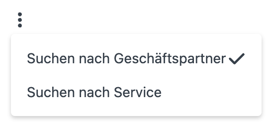

# Core Components Documentation

---

### Andp Text




**Example:**
`````TSX
<AndpText size={theme.fontSize.large}>Demo Text</AndpText>
`````

You can use all the properties which are included in the `React Native Text Component`, plus the following:
**Properties**
| Prop name | Accepted values | Required | Description | Default value |
|-----------|----------------|----------|-------------|---------------|
| `size` | `number` | no | sets the size of the font | `theme.fontSize.regular` |
| `weigth` | `'normal'`, `'bold'`, `'100'`, `'200'`, `'300'`, `'400'`, `'500'`, `'600'`, `'700'`, `'800'`, `'900'` | no | sets the weight of the font | `theme.fontWeight.regular` |
| `color` | `string` | no | sets the color of the font | `theme.colors.textPrimary` |

---

### Andp Input Element




**Example:**
`````TSX
<AndpInputElement
  icon={<AndpIcon name='search' size='md'/>}
  placeholder={selectedSearchFilter.label}
  onChangeText={handleSearch}
  placeholderTextColor={theme.colors.textMuted}
  style={messagesStyle.messageSearchFilterInputContainer}
  flex
  rightElement={[
    <DropDownMenu 
      key={1}
      closeOnOutsideClick={false}
      options={messageFilterOptions}
      onChange={(selected) => setSelectedSearchFilter(selected)}
      >
        <AndpIcon name={'verticalDots'} size='md'/>
    </DropDownMenu>
  ]}
/>
`````

You can use all the properties which are included in the `React Native TextInput Component`, plus the following:
**Properties**
| Prop name | Accepted values | Required | Description | Default value |
|-----------|----------------|----------|-------------|---------------|
| `flex` | `boolean` | no | The `flex`-Prop controls whether the `AndpInputElement` adopts a flexible layout behavior. **`flex = false` (default)** → The input field takes up the full width of its parent container (`width: '100%'`). **`flex = true`** → The input field occupies the full width of the available space. Set it to `false` if the input field is the only element in a container. Set it to `true` if the input field is inside a container with other elements and needs to share the available space. | `false` |
| `icon` | `ReactNode` | no | use this for setting an Icon on the left side in the Input Element | `null` |
| `rightElement` | `ReactNode[]` | no | use this for setting any component in the right side of the Input Element. For Example if you want to have a buton in the Input Element | `null` |
| `inputStyle` | `StyleProp<TextStyle>` | no | style for detail styling of the input Element. For exmaple styling the placeholder text. | `null` |

---

### Andp Icon


An Icon Provider/Wrapper in order to keep the code more flexible and clean. 
Use this component to insert Icons by passing the name of the icon as a prop to the component.

**Example:**
`````TSX
<AndpIcon name='search' size='md'/>
`````

**Properties**
| Prop name | Accepted values | Required | Description | Default value |
|-----------|----------------|----------|-------------|---------------|
| `name` | `string` | required | chooses witch icon to display | - |
| `size` | `'sm'`, `'md'`, `'lg'` | no | sets the size of the icon with the following values: `'sm' = 12`, `'md' = 18`, `'lg' = 24` | `md` |
| `color` | `string` | no | sets the color of the font | `theme.colors.textOnGray` |
| `style` | `ViewStyle` | no | sets additional styling for the icon | `null` |

---

### Drop Down Menu



A Drop Down Menu, which uses a button as a trigger for opening the dropdown, but you can insert any ReactNode Component in the button in order to customzie it.
To add a component for the trigger button just insert it as a JSX child to the DropDownMenu JSX Component

**Example:**
`````TSX
<DropDownMenu 
  key={1}
  options={businessCaseFilterOptions}
  onChange={(selected) => setSearchType(selected.value)}
  modalAlignment='left'
>
  <AndpIcon name={'verticalDots'} size='md'/>
</DropDownMenu>

// businessCaseFilterOptions
const businessCaseFilterOptions: IDropDownSelectOption[] = [
  { label: t('business_partner_search_partner'), value: 'partner' },
  { label: t('business_partner_search_service'), value: 'service' },
];
`````

**Properties**
| Prop name | Accepted values | Required | Description | Default value |
|-----------|----------------|----------|-------------|---------------|
| `options` | `IDropDownSelectOption[]` | required | A list with the options. The options must implement the `IDropDownSelectOption` Interface. A description of the interface is written below the table | - |
| `onChange` | `(selected: any) => void` | no | It's an event which is triggered when a user selects one of the options from the menu. The `selected` property contains the `IDropDownSelectOption` item which was selected by the user | null |
| `modalAlignment` | `'left'`, `'right'` | no | This property defines where to align the menu realtive to the trigger button. | `right` |

**IDropDownSelectOption**
````TSX
interface IDropDownSelectOption {
  label: string;
  value: any;
}
````