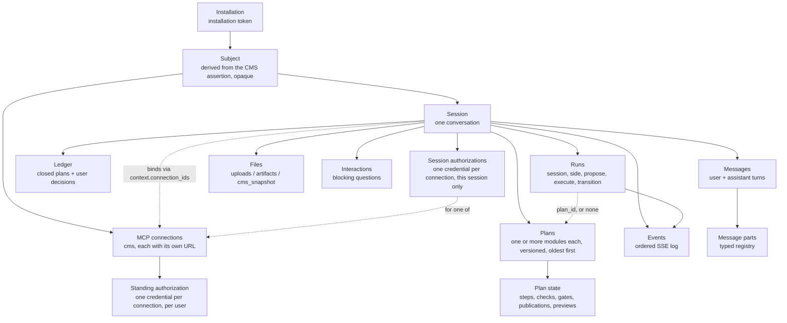
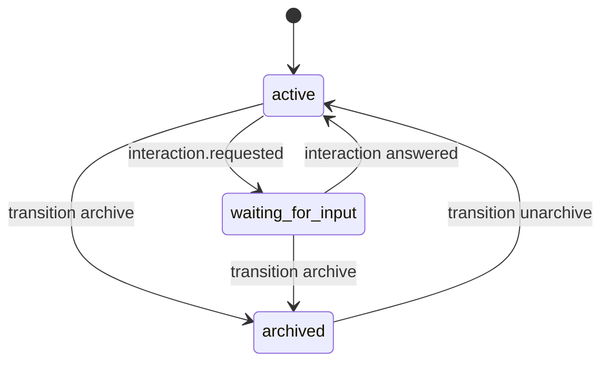

# The GenAIx API

This is the narrative guide to `openapi.yaml`, the normative contract for **GenAIx API v1**, for
the Workspace UI developer and for the team integrating the CMS authentication and streaming
proxy. Proxy implementation requirements (header forwarding, stream buffering, timeouts) are in
`09-integration-guide.md`. Every route, field, event type and part type named below exists
verbatim in `openapi.yaml`; where this document simplifies for readability, the OpenAPI file is
the tie-breaker.

Read `01-architecture.md` first for why the API is shaped this way, and
`02-auth-and-context-flow.md` for the full header and credential story. Worked examples live in
`examples/`: `session-lifecycle.md` walks the same ground with more prose, `requests.http` is the
same sequence as runnable HTTP requests, and the `.sse` transcripts are complete, schema-valid
event streams.

This API is **client-agnostic**: it describes sessions, plans, events, parts and plan state, never
screens or layouts. Different clients are expected to render this data differently; nothing
below constrains how a client draws anything.

## 1. Purpose and versioning policy

A GenAIx **session** is **one conversation** (since `1.0.0-rc.4`; until then one user task).
A session accumulates **messages**; each user message starts a **run**; a run emits an ordered
**event** stream that a client renders as chat parts, plan cards, steps, checks and CMS
previews. The work the conversation carries out is a sequence of **plans** — create a landing
page, edit four of the pages a search found, draft a construct, provision a user. Each plan
is carried out by one or more workflow modules (since `1.0.0-rc.5`; by one before), is proposed
by the agent and accepted by the user, and has its own steps, checks, gates, derived settings,
previews, publications and lifecycle (§4.1). A plan is **living** (since `1.0.0-rc.5`): a
follow-up on the same work revises it as a new version, the items it already finished kept, and
the user accepts each version (§4.4). Reading and answering need no plan: the built-in **session
agent** does that in every session.

The contract is `v1`, served at `/api/v1`, JSON, `snake_case` field names, ISO 8601 timestamps
with an explicit offset. This document describes **`1.0.0-rc.5`**, agreed by all parties on
2026-10-15 and frozen for development: implementations build against it as it stands. Where this
document says "since `1.0.0-rc.5`", rc.4 behaves as the same sentence says it did before. A change is made only by
agreement, recorded in the changelog, with a breaking change only where no additive form
exists. §16 lists what `1.0.0-rc.5` changes against `1.0.0-rc.4`, what `1.0.0-rc.4` changed
against `1.0.0-rc.3`, and what `1.0.0-rc.3` changed against `1.0.0-rc.2`. At `1.0.0` the contract is frozen and every
change is **additive only**: new optional fields, new enum members, new event types, new part
types, new routes. Removing or renaming anything requires a `v2`.

Forward compatibility is load-bearing from day one: every client **must** ignore an unknown
`event:` name (drop the frame, keep consuming, never treat it as an error) and **must** tolerate
an unknown message part type (render its `text` field if present, otherwise skip it silently,
never fail the whole message). Both rules are documented formally as `UnknownPart` and the
client-rules list on `GET /sessions/{session_id}/events` in `openapi.yaml`, and apply equally to
`schemas/events.schema.json` and `schemas/parts.schema.json`.

## 2. Base URL, headers and who calls this API

Two callers are in scope for this API, besides external LLM agents, which call `cms-mcp`
directly with their own CMS API token and never call this API at all. They reach it in one of
two **caller modes**, told apart by the presence of `X-GenAIx-Installation` (`1.0.0-rc.3`):

1. **Proxied (production): the CMS custom proxy.** This is the path the Workspace UI takes.
   The CMS's existing custom proxy (`/rest/proxy/{key}`, configured once for GenAIx, with no
   change to the proxy itself; configuration in `09-integration-guide.md`) authenticates the
   browser by its CMS session, adds the installation token as a static configured header
   `X-GenAIx-Installation`, adds `Authorization: Bearer <CMS identity assertion>`, an RS256
   JWT it signs per request with the CMS's own key, and passes SSE through (per-chunk flushing
   arrives with the CMS change GPU-2665).
2. **Direct (development, mocks, tooling, conformance).** `Authorization: Bearer <installation
   token>` plus `X-GCMS-Subject: <opaque>`, used verbatim as the subject. The local mock server
   (`mocks/genaix-mock`, at `http://localhost:8080/api/v1`), the reference client and the
   conformance suite use this mode. It is accepted only by an installation **without** a CMS
   key configured.

| Header | Direction | Required | Meaning |
|---|---|---|---|
| `X-GenAIx-Installation: sk_gnx_...` | request | proxied mode, on every route | The GenAIx installation token, a static `headers` entry of the custom proxy that replaces any client-sent value. Its presence selects proxied mode. Identifies the CMS installation, not the user. |
| `Authorization: Bearer <token>` | request | direct mode: on every route; proxied mode: on every user route | Proxied mode: the CMS identity assertion (on user routes; ignored on installation-level routes). Direct mode: the GenAIx installation token. |
| `X-GCMS-Subject` | request | direct mode, on every user route | An opaque, installation-scoped, pseudonymous subject, used verbatim. Ignored on a proxied request. |
| `X-HTTP-Method-Override: PATCH` | request | no | Sent with `POST` on a route that defines `PATCH`, for callers that cannot send `PATCH` (the custom proxy forwards only `DELETE`, `GET`, `HEAD`, `OPTIONS`, `POST`, `PUT`). |
| `X-GenAIx-Request-Id` | response | always | Correlates one response with support/debugging logs. |

That is the **whole** header contract: one installation token and one identity, nothing else.
Sessions are owned by `(installation token, subject)`. GenAIx never holds a CMS session cookie
or secret of any kind and ignores cookies the proxy forwards. It uses the subject purely as the
owner key of sessions, files, connections and authorizations. Acting on the CMS as the user is a
separate concern, handled entirely by the MCP-connection model in §2.1, with its own credential
registered through its own routes, never carried as a header.

**Verifying the CMS assertion** (proxied mode). It must be a compact JWS with `alg` `RS256`
only, signed by one of the installation's configured CMS public keys, each a JWK exactly as the
CMS serves it at `GET /rest/admin/publicKey`. A `kid`, when present, selects the key; otherwise
every configured key is tried, so rotating the CMS key is "add the new key, remove the old one
later". `iss` must equal the installation's expected issuer (default `Gentics CMS`); `sub` must
be a non-empty string; `iat` is required and must lie within 60 seconds of GenAIx's clock either
way (configurable per installation); `exp` and `nbf` are honoured when present. Every other
claim is ignored.

**Deriving the subject.** GenAIx derives the subject from `sub` itself: deterministic per
installation and `sub`, a keyed one-way hash under a secret only GenAIx holds (HMAC-SHA-256
recommended), opaque on the wire and at most 4096 characters. The same login maps to the same
subject from any device; a changed login, or a changed `jwt.prefix` on the proxy, is a new
subject. In direct mode the `X-GCMS-Subject` value is the subject as sent.

**Data handling.** The assertion lives for the request only: it is never stored, logged,
emitted in an event, put into a prompt or forwarded to an MCP server, and access logs must not
record `Authorization`. Of its claims GenAIx uses `sub` alone, and it persists the derived
subject and nothing else of the person: **GenAIx keeps nothing that names the person**.
`GET /me` reports `user: {subject}` and nothing more.

**Identity errors.** A proxied request on a user route without an assertion, or a direct one
without `X-GCMS-Subject`, is `400` with `genaix_code: subject_missing`, never treated as
anonymous or as the installation itself. An assertion that fails any rule above, a proxied
request to an installation with no CMS key configured, and a direct user-route request to an
installation with one are all `401 identity_invalid`. The rc.2 variant in which `X-GCMS-Subject`
itself carried an HS256-signed assertion is removed; the CMS assertion supersedes it.

**Installation-level routes** — `GET /ping`, `DELETE /subjects/{subject}` and
`POST /subjects/erase` — take the installation token in either header (`X-GenAIx-Installation`
or `Authorization`) and ignore any assertion. The two erasure routes remove every session,
message, file, connection and authorization of one subject, for when the CMS deletes the user
behind it — the only way that deletion can ever be triggered, since GenAIx cannot resolve a
subject back to a person. `DELETE /subjects/{subject}` names the subject; `POST /subjects/erase`
takes exactly one of `{"cms_sub": "<the assertion's sub>"}` or `{"subject": "..."}`, so the CMS
can erase by login without knowing the derived subject and the login stays out of URLs and
access logs. Both answer `204` and are idempotent; `cms_sub` needs a CMS key configured on the
installation, otherwise `422`. A login reused after its first owner was deleted maps to the same
subject again, and inherits nothing only if the CMS side called one of these routes.

**`PATCH` through the proxy.** Every `PATCH` route also accepts `POST` with
`X-HTTP-Method-Override: PATCH`, with the same semantics; any other override value is `400
malformed_request`.

The full actor/credential table, the sequence diagrams, and the audit-header story
(`X-GenAIx-Session`, `X-GenAIx-Run`, sent from GenAIx to `cms-mcp`) are in
`02-auth-and-context-flow.md`.

### 2.1 MCP connectors, connections and standing authorization

Acting on the CMS — or on any other system an agent needs — is not a fixed "one server per
installation" concern: GenAIx separates the **kind** of system from the **address** of a
particular instance of it.

- A **connector** is the kind: `GET /mcp/connectors` is the read-only catalogue GenAIx defines —
  `cms` is the only one in Phase One — with `type`, `transport` (`streamable_http`), `auth`
  (`type`: `none`\|`bearer`\|`oauth2`, plus a `token_hint`), `tool_groups`,
  `required_by_workflows`, `multiple` (whether a user may hold more than one connection of this
  type — `true` for `cms`), and two non-binding URL conveniences, `url_template` and
  `default_url`. **Connector types cannot be added, changed or removed through this API.**
- A **connection** is one user's address for an instance of a connector type: `GET /mcp/connections`
  lists the caller's connections; `POST /mcp/connections {connector, url, label?, default?}`
  creates one — **the client supplies the `url`**, GenAIx never derives it. URL rules: `https`
  required except for `localhost`/`127.0.0.1`; no embedded credentials, query string or fragment
  (`422 validation_failed` otherwise, and likewise for a second connection of the same type at
  the same URL). The reachability probe recorded in `status` is **informational only** — a
  connection can be registered before its server is up, and against a server that authenticates
  its transport an unauthenticated probe sees only the `401`, which counts as reachable **without
  `server_info`**; `server_info` appears once a probe ran with a credential. `label` is always
  present, the URL host by default. `PATCH`
  changes `url`, `label` or `default` (changing `url` **drops the stored credential**); `DELETE`
  removes the connection and credential, revoking nothing server-side. `409 mcp_connection_limit`
  above `max_connections_per_connector` (default 10), or when `multiple` is `false` and one
  already exists.
- **Standing authorization lives on the connection**: `GET|PUT|DELETE
  /mcp/connections/{connection_id}/authorization`. `GET` verifies **live** — it calls the
  connection's URL with the stored credential (`whoami`; `tools/list` counts as proof only for a
  connector with `auth.type: none`) and reports only whether it still works, never who it
  resolves to — and returns `status`
  (`authorized`\|`unauthorized`\|`pending`\|`invalid`\|`expired`). `PUT {auth_type: bearer,
  token, token_name?, expires_at?}` verifies before storing — `422 mcp_authorization_rejected`
  on refusal, `424` if unreachable — and stores nothing on failure; a credential whose
  `expires_at` already passed is stored as `expired`. `how_to_authorize.token_name` is
  `genaix-<installation slug>` here and `genaix-<session id>` for a session credential, so a
  client can key its token bookkeeping on it. `{auth_type: oauth2, action:
  start}` begins the MCP OAuth 2.1 flow server-side; Phase One supports `bearer` tokens only.
  This credential is
  **per user**, long-lived, and independent of any one session — the path for the
  non-integrated GenAIx UI and for tooling, where nothing mints a token per task. §2.2 covers
  the narrower, session-scoped credential the integrated path uses instead.

**The client provisions; GenAIx only verifies, stores, uses and reports.** When the installation
is configured with a CMS base URL, the first `GET /mcp/connections` a user makes auto-creates
their default `cms` connection there (`authorization_status: unauthorized`), so a client never
has to create a connection explicitly, only register a token on it — a user who wants a second
CMS calls `POST` or `PATCH` directly. GenAIx never holds a CMS session cookie and never creates a
credential on the target system itself: the client obtains the token from that system on its own
and registers it with `PUT` (the exact CMS call sequence is in `09-integration-guide.md`). GenAIx
then sends that token as the bearer credential on every call through that connection, per run,
never shared between users, so every CMS read and write runs as that user and is audited under
their name; because the token is independent of the browser session, a running agent session
survives the user logging out.

A session binds one connection per connector type it needs (since `1.0.0-rc.4`): the types each
plan's workflow requires, plus those the session agent reads through — every read group of the
installation's connectors, so in Phase One the `cms` connection. `SessionContext.connection_ids`
names them explicitly, or, when omitted, the user's `default` connection of each such type is
used. `CmsObjectRef.connection_id` records which connection produced each object, so an object
stays unambiguous when more than one CMS is in play. `GET /me` summarizes every connection the
user holds as `mcp_connections: [{id, connector, label, url, default, authorization_status}]`.
Anything but `authorized` removes every workflow whose non-optional `required_connectors` entry
names that type from `capabilities.workflows`. That narrowing, together with each module's own
rules and the installation configuration, is the **whole** calculation: it never involves group
membership or the manifest's `roles`, because GenAIx is never told which groups a caller belongs
to — the target system enforces permission on every tool call regardless. A client cannot
reproduce the calculation and must not try to: it offers exactly the workflow ids
`capabilities.workflows` returns, and re-reads them after registering an authorization, since a
newly authorized connection can widen the list. The list is a **hint**, not a creation rule
(`1.0.0-rc.2`). `workflow` on `POST /sessions` is optional since `1.0.0-rc.4` — without it the
session agent starts — and when sent it is refused only when no module of that id is installed
(`422 unknown_workflow`): a plan of a workflow the caller cannot act in yet is drafted, and its
run answers `auth.required`. Credentials sent in `authorizations` on the create call count for
that session at once.

**Failure is not paused, it is immediate.** When a run needs a connection with no usable
credential at either scope (§2.2), GenAIx emits `auth.required {connection_id, connector,
reason: unauthorized|invalid|expired|unreachable, how_to_fix}` and the run fails right after with
`424 mcp_authorization_required` — there is no `waiting_for_input` grace period for a connection
problem. The client registers (or re-registers) an authorization, then re-sends the message that
failed. `examples/s5-failure-and-recovery.sse` is a full transcript of exactly this. A required
connector type for which the installation offers no connection at all is not a credential problem
but a configuration error: the run fails with `503 service_unavailable` and no `auth.required`
precedes it, since there is no `connection_id` to name.

### 2.2 Session-scoped authorization

The standing authorization in §2.1 is deliberately long-lived. The **integrated path** — the
Workspace UI, and any client minting a token per task — instead scopes the credential to **one
session**, so nothing long-lived is ever stored and a GenAIx-side incident exposes only the
sessions open at the time.

- `GET /sessions/{session_id}/authorizations` lists the connections this session holds its own
  credential for, verified live — GenAIx calls the connection's URL with the stored credential
  and reports only whether it still works, never who it resolves to — as `SessionAuthorization`
  items (`connection_id`, `connector`, `status`: `authorized`\|`invalid`\|`expired`,
  `token_name?`, `expires_at?`, `registered_at`, `verified_at?`) — never the credential itself.
  A connection with no entry here simply has none at this scope.
- `PUT /sessions/{session_id}/authorizations/{connection_id} {auth_type: bearer, token,
  token_name?, expires_at?}` registers or renews it, verified live before storing — `422
  mcp_authorization_rejected` on refusal, the previous credential left untouched. `409
  session_archived` once the session is `archived` — exactly the sessions whose credentials
  GenAIx has already deleted. Every other session accepts one, whatever its plans' statuses
  (since `1.0.0-rc.4`; before, `409 session_released` also for a `published` or `discarded`
  session).
- `DELETE /sessions/{session_id}/authorizations/{connection_id}` forgets the credential in
  GenAIx — idempotent, `204` either way — without revoking it on the target system.
- `POST /sessions` accepts the same shape as `authorizations: [{connection_id, auth_type: bearer,
  token, token_name?, expires_at?}]` alongside `message` (§4), so a client creates the token on
  the target system, the session and the first turn in one round trip.

**GenAIx never creates a credential** at either scope: the client obtains the token from the
target system itself. Registering one here binds it to this session, for this session's runs
only, and it is never returned by any route, never logged, and never reaches the model — the
harness attaches it to outbound MCP calls outside the model's context.

**Lifetime.** GenAIx stops using a session credential and deletes the stored token at the first
of: the session being archived or deleted; the client deleting it; or `expires_at` passing
(since `1.0.0-rc.4`). A plan's status never ends it: plan transitions do not touch the
session's credentials, and the conversation's next plan acts with the same credential. Before
`1.0.0-rc.4` it also ended when the session reached `published` or `discarded`.

**Precedence.** A session works through the connections named in `context.connection_ids` (§4).
For each one, GenAIx looks first for a session authorization; when none exists, or it is not
`authorized`, it falls back to the caller's standing connection authorization (§2.1). **When
both exist for the same connection, the session one wins.**

`Session.authorizations` and `PlanState.authorizations` (§8; the latter limited to the
connections that plan's modules require) both carry a short `SessionAuthorizationSummary` per
credential (`connection_id`, `status`, `expires_at?`) — enough
for a reconnecting client to tell whether the session can still act before sending the next
turn, since a session credential can have expired while the client was away; `GET
/sessions/{session_id}/authorizations` has the full detail.

## 3. Resource model



A session is owned by the pair `(installation_token_id, subject)`. An unknown session id, or
one belonging to a different installation, is `404`; a session of a different subject under the
same installation is `403`. A plan belongs to exactly one session and is addressed under it
(`/sessions/{session_id}/plans/{plan_id}`); a plan id the session does not have is `404
plan_not_found`. MCP connections and their standing authorizations are scoped to the subject,
not to any one session, so a connection registered once is reused by every session that needs
its connector type; a session's own authorizations (§2.2) are narrower still — bound to that one
session, shared by all its plans, and gone once the session is archived or deleted. Nothing in
this API is addressable outside a session except `/me`, `/ping`, `/workflows`,
`/subjects/{subject}`, `/subjects/erase` and the `/mcp/connectors`/`/mcp/connections`
resources.

### 3.1 Invariants and the agent's context

Six rules hold for every session (since `1.0.0-rc.4`). GenAIx enforces them in the harness; a
workflow module can tighten them but never loosen them, and none is left to the model.

1. **Plans never mix.** Every write, check, gate result, snapshot, preview and publication
   belongs to exactly one plan (`plan_id`); at most one plan of a session executes at a time; a
   final plan (`discarded`, `superseded`) never changes again, and any other plan changes only
   through a new version the user accepts (since `1.0.0-rc.5`; a closed plan never changed again
   before).
2. **The agent always knows the current task.** Every run's context starts with the plan the
   conversation currently works on (`Session.open_plan_id`); closed plans appear as a factual
   history.
3. **Only user-approved actions change anything.** CMS write tools exist only in the run of a
   plan the user accepted, in the version that contains the write, and a write must target an
   object of that plan, otherwise it is
   refused before it reaches the CMS (`422 plan_scope_violation`, §9.1). Releasing, publishing
   and requesting review are the user's transitions of a plan (§4.2).
4. **Read-only work is free.** Search and read tools are available in every state of the
   session, with or without a plan, and need no approval — also while a plan executes (side
   runs, §5).
5. **The agent proposes, the user accepts in the card.** A plan becomes executable only through
   the user's own message accepting a specific plan version, as proposed or adjusted (§5.3).
6. **Nothing of the conversation is lost.** The messages and the ledger are the complete record;
   what the agent sees is built from them, and every part of it can be recalled exactly.

**How the agent's context is built** (normative behaviour, not a wire format). Every run's
context is assembled by GenAIx from the session's record, in this order:

1. **Current task**, always first: the plan the conversation currently works on
   (`open_plan_id`) with its id, modules, version, status, items with their status, module and
   target, what waits for the user, and the user's last decision on it; and the other open plans
   (`open_plan_ids`, since `1.0.0-rc.5`), so a follow-up can revise the one it concerns. A side
   run sees the executing plan, read-only.
2. **The ledger**, always, never compacted: per plan its modules, accepted versions and items,
   the objects written with their versions, check and publication outcomes; every revision with
   its version, who asked and why (since `1.0.0-rc.5`); and every user decision (acceptances and
   adjustments, settings confirmations, interaction answers, transitions with their comment). The ledger is stored for the session's lifetime and erased
   with it, independent of event retention (§6.1).
3. **Recent turns** verbatim within a budget, with structured parts rendered compactly (a table
   as its rows, citations as a reference list, a page structure as a block summary).
4. **Older prose** as a rolling summary, made at turn boundaries only and never while a plan
   executes. Each compaction emits `status` with `kind: context_compacted` (§6); a client may
   show it or ignore it. Items 1 and 2 are never summarised.
5. **Recall**: the read-only `genaix` tool `recall` returns earlier turns, parts, tool results,
   ledger entries and still retained events exactly — by plan, object, time range or text —
   from this session and the sessions it `continued_from` (§4.3), same installation and subject
   only.

## 4. Session lifecycle

`POST /sessions` can create a session and send its first user turn in a single call. Alongside
`workflow` (optional since `1.0.0-rc.4`, below), `title` and `context`, it accepts an optional
`message` — the same body as `POST /sessions/{session_id}/messages` (§5.1) — and an optional
`authorizations` array of session credentials, one per connection (§2.2). Together they let the
integrated path do everything in one round trip: create a token on the target system, register
it, create the session and send the first turn. When `message` is present, GenAIx creates the
session, derives `intent` from the message's plain rendering, appends it as the first user turn
and starts its run, all in one call: the `201` (`SessionCreated`) carries the session plus
`run_id`, `message_id` and `events_url`, so the client goes straight to the event stream. This
is the normal path for a turn the user typed, and `parts` is the shape to send — a client with
no part-aware composer sends `content` instead, the plain client variant, with the same effect.

**With or without a workflow** (since `1.0.0-rc.4`). Without `workflow` the session starts with
the **session agent**: the first message goes to it, it reads and answers, and it drafts a plan
when the user asks for a change. That is the normal start of a Workspace conversation. With
`workflow` — a CMS context action such as "Create page here", or any client that knows the
module up front — the session's first plan is drafted at once, naming that module as the one the
user expects, and `message` goes to that plan's proposing run (§5.3), which may add the further
modules the work needs (since `1.0.0-rc.5`). Either way the session has no workflow of its own:
the modules and their versions belong to each plan (`Plan.workflows`, since `1.0.0-rc.5`;
`workflow` and `workflow_version` in rc.4), and `SessionPatch` has no `workflow` member, so a
`PATCH` carrying one is `422 validation_failed`.
`Session.inputs` holds the module inputs of the first plan when the session was created with a
`workflow`, and is empty otherwise.

Leaving `message` out creates an empty session with an empty `intent`; the first turn is then
posted separately. Both flows stay valid, and the two-call flow is the one to use whenever the
turn needs an attachment: files are **per session**, so none can exist before the session id
does — a `message` sent to `POST /sessions` cannot carry `files` or a `file_ref` part (`422
validation_failed`). A turn with an attachment is therefore three calls: create the session,
upload through `POST /sessions/{session_id}/files`, then post the message with the returned
file id.

`intent` is **derived and read-only**: the plain rendering of the first user message, never a
field a client sets or patches. It stays empty until that message arrives, and it is what the
session list's `q` searches, next to `title`.

`context` is a `SessionContext`: `node_id`, `folder_id`, `language`, `template_id`, an array of
typed `ContextReference` entries, a list of `guidelines` ids, and `connection_ids` (§2.1) — the
MCP connections this session works through, defaulting to the user's `default` connection of
each connector type its plans and the session agent need when omitted. Context is **never plain
text** — an at-mention, a tree selection, a guideline or an uploaded file all arrive as a
`ContextReference` (`type`, `id`, optional `label`/`node_id`/`global_id`), so the agent resolves
them through CMS tools instead of guessing from a string.

`continued_from` (optional, a session id) links the new conversation to an earlier one
(`1.0.0-rc.3`, §4.3).

### 4.1 Session status and plan status

Since `1.0.0-rc.4` there are two state machines: the session's, which says whether the
conversation can take a turn, and each plan's, which carries the work. What rc.3 called the
session statuses `released`, `published`, `review_requested` and `discarded` are plan statuses
now.

**The session** (`SessionStatus`: `active`, `waiting_for_input`, `archived`):



`archive` cancels an active run, hides the conversation from the default list and deletes its
session credentials (§2.2); its plans keep their statuses, and an open plan is acted on again
after `unarchive`. An archived session refuses messages, uploads, file deletion and credential
registration with `409 session_archived`. Hard deletion is an administrative operation outside
this API. **A plan's status never blocks a message**: a session with a `released` or `published`
plan takes the next turn like any other.

**A plan** (`PlanStatus`, living since `1.0.0-rc.5`):

```
drafting ─► proposed ─► accepted ─► running ─► done ─► released ─► published / review_requested
              ▲  │          │          │        │        │              │
              │  └ adjust   └── redirect ──┘    │        │              │
              │                                 │        │              │
              └─────── revise (version + 1, finished items kept) ───────┘
any open status ─────────────────────────────────────────────► discarded
```

| Status | Meaning | Moved by |
|---|---|---|
| `drafting` | The session agent drafted new work (its `draft_plan` tool, or `workflow` on `POST /sessions`) or a revision (`revise_plan`, a redirect or `options.mode: revise`; since `1.0.0-rc.5`); the plan's proposing run reads and plans with every write withheld | session agent, or the router on a redirect |
| `proposed` | A plan version waits for the user | harness, when the proposing run ends |
| `accepted` | The user accepted a version, as proposed or adjusted — only the user's own message does this (§5.3) | user |
| `running` | A run carries the plan's `pending` items out | harness |
| `done` | The run finished the plan's items; the `step_end` gates ran. A `plan` part naming it without `items` runs it again (`running`) within the scope the user accepted | harness |
| `released` | The `before_release` gates passed; the plan's pages wait to be published | user (`release`) |
| `published` / `review_requested` | Every publication of the plan went out, or at least one waits for approval and none failed (§4.2) | user (`publish`, `request_review`) |
| `discarded` | Abandoned; pages already written stay or are restored per `plan_policy.on_discard`, the strictest value of the plan's modules | user (`discard`) |
| `superseded` | Replaced, while `drafting` or `proposed`, by unrelated work the user started instead and said so; nothing was written for it (since `1.0.0-rc.5`; a new proposal of the same work revises the plan) | session agent |

What the user does, and what the plan becomes:

| From | The user… | Becomes |
|---|---|---|
| `drafting` | writes something else about the same work | its proposing run is redirected: `run.cancelled` with `cancel_reason: redirected`, started again with the message (§4.5) |
| `proposed` | accepts it as proposed (`plan` part without `items`) | `accepted` at the same version |
| `proposed` | adjusts it in the card (`plan` part with `items`) | `accepted` at version + 1 |
| `proposed` | writes something else about the same work | `drafting`, then `proposed` at version + 1 (§4.4) |
| `accepted`, `running` | asks a question | unchanged; a side run answers (§5) |
| `accepted`, `running` | redirects ("stop, use red instead") | `run.cancelled` with `cancel_reason: redirected`, then `drafting`, then `proposed` at version + 1 (§4.5) |
| `done`, `released` | writes a follow-up on the same work | `drafting`, then `proposed` at version + 1 (§4.4) |
| `published`, `review_requested` | writes a follow-up on the same work | `drafting`, then `proposed` at version + 1, `closed_at` cleared (§4.4) |
| any open status | discards it | `discarded` (§4.2) |

The statuses fall into three classes (since `1.0.0-rc.5`):

- **Open**: `drafting` to `released`. **Executing**: `accepted` and `running`.
- **Settled**: `published`, `review_requested`. Closed, but revisable: a follow-up on the same
  work makes the plan `drafting` again.
- **Final**: `discarded`, `superseded`. They never change again.

Closed means settled or final. rc.4's `reopen` is gone: a revision replaces it. A failed or
cancelled run leaves its plan where it was (`accepted` after a failed execute run, `drafting`
after a failed proposing run); the user's next message retries. A run cancelled by a redirection
leads to the revision instead (§4.5).

**Several plans may be open; at most one executes at a time** (since `1.0.0-rc.5`; rc.4 allowed
one open plan unless the module's `plan_policy.concurrency` said otherwise, and that member is
removed). A follow-up revises the plan it concerns instead of waiting for it to close, so
unrelated work can be drafted next to a plan that waits for release or publishing.
`Session.open_plan_id` is the plan the conversation currently works on, the most recently drafted
or revised open plan, and the one a `revise` message revises by default; `Session.open_plan_ids`
lists every open plan, oldest first; `Session.executing_plan_id` names the one that is `accepted`
or `running`.

A plan whose modules have **no CMS write tool** (`content_research`) needs no acceptance: it
goes from `drafting` to `running` at once, because reading is free. A plan with any module that
has a write tool needs the user's acceptance before its first write (§5.3).

`failed` is deliberately **not** a status, of either machine: a failure belongs to a `Run`. The
session stays `active` and the plan keeps its status, so the user can simply retry.

### 4.2 Transitions

Every user-driven status change of a plan goes through one route, `POST
/sessions/{session_id}/plans/{plan_id}/transitions` (`TransitionRequest`, since `1.0.0-rc.4`;
the session's own transitions before), so a client has one button handler per plan card and the
server keeps the state machine in one place. The session stays `active` throughout; only the
plan moves.

| `action` | from (`PlanStatus`) | to | starts a run |
|---|---|---|---|
| `release` | `done`, `running` (which it stops) | `released` | no (runs the gates, then cancels the plan's active run) |
| `publish` | `released` | `published` or `review_requested` | yes |
| `request_review` | `released` | `review_requested` | yes |
| `discard` | any open status | `discarded` | only with `on_discard: restore` |

Accepting a plan is **not** a transition: it is the user's message (§5.3), so the acceptance is
part of the conversation. Neither is revising it (since `1.0.0-rc.5`, which removes rc.4's
`reopen`): a message about the work of a `done`, `released`, `published` or `review_requested`
plan makes it `drafting`, then `proposed` at the next version (§4.4); the pages of a published
plan stay online until the next `publish`. `release` and `discard` (with `on_discard: keep`)
are synchronous and return the updated `Plan` with `200`. `publish` and `request_review` are
asynchronous — they go through `cms-mcp` into the CMS — and return `202 TransitionAccepted`
with `run_id` (a run of mode `transition`, §5), `plan` and `session`. `publish` accepts an
optional `at` timestamp to schedule the CMS publish.

The session's own route, `POST /sessions/{session_id}/transitions`, keeps only `archive` and
`unarchive` (`SessionTransitionRequest`, since `1.0.0-rc.4`):

| `action` | from (`SessionStatus`) | to |
|---|---|---|
| `archive` | `active`, `waiting_for_input` | `archived` |
| `unarchive` | `archived` | `active` |

Both return the `Session` with `200`; neither touches a plan. Any other action there is `409
workflow_transition_invalid`.

**One outcome per page, per plan** (`1.0.0-rc.3`, per plan since `1.0.0-rc.4`, every module). A
plan publishes **every page it created or changed**: its `cms_objects` entries with operation
`created` or `updated`, in the order of their first write. `PlanState.publications` (§8) holds
one `Publication` per such page, carrying the plan's `plan_id`, `pending` until a `publish` or
`request_review` reaches it; pages another plan of the session wrote are never touched. The
publications of a revised plan accumulate over its versions (since `1.0.0-rc.5`): a page a later
version wrote again is `pending` again, and `publish` sends out the pages of every version. Whether
a page is published directly or goes to review is decided **server-side, per page**, from the
calling user's CMS permissions on that page's own folder, so one transition can publish some
pages and send others to review. `publish` handles every entry that is `pending` or `failed`,
each directly or via review as its folder decides; `request_review` sends each of them to
review; `at` applies to all of them. Every change to the entries is announced by
`publications.updated` with the plan's `plan_id`. The plan status after the run follows from
the entries:

- `published` when every entry is `published`;
- `review_requested` when at least one entry is `review_requested` and none is `failed`;
- any `failed` entry fails the run and leaves the plan `released`. The entries that did go out
  stay `published` or `review_requested`, and a repeated `publish` retries only the `pending`
  and `failed` ones.

A `publish` the CMS converts into a review request still returns `202`. For a plan that changed
one page, all of this reduces to the single outcome rc.2 described, and the plan-level
`approval_chain` is that page's chain. There is no partial discard: a user who does not want a
page changed removes it from the work by adjusting the plan before accepting it (§5.3).

**Discard** follows `plan_policy.on_discard` (§8), the strictest value of the plan's modules
(since `1.0.0-rc.5`; `restore` over `keep`): `keep` (the default) leaves the
pages the plan wrote as they are, unpublished changes staying as drafts in the CMS, and answers
`200`; `restore` restores each page's version from before the plan in a transition run and
answers `202`, the plan becoming `discarded` once the run has landed. Discarding a plan that wrote
nothing just closes it (`200`). The conversation goes on either way.

Three details fixed in `1.0.0-rc.2`, per plan since `1.0.0-rc.4`. The `202` body carries the
plan **as it is when the call returns** (`released`); the outcome arrives on the stream and in
the next `GET /sessions/{session_id}/plans/{plan_id}`. Repeating `discard` on a `discarded` plan
is `200` with the plan and no event, as is `archive` on an `archived` session or `unarchive` on
an `active` one; only a real change appends `plan.updated` with the new `status` (or, for the
session, `session.updated` with `changed: [status, updated_at]`). And `request_review` reaches
the CMS only for a page the user cannot publish directly, because the CMS has no call that
submits a page for review: its `publish_page` queues the page for approval when the user lacks
`publishpages` on its folder, so for such a page `request_review` calls it and the CMS queues
the page, while for a page the user may publish it is a GenAIx-side step — the entry becomes
`review_requested` with the approval step `pending`, no CMS write happens, and a later `publish`
performs it. `publish` maps the CMS outcome `published` or `scheduled` to the entry status
`published` and `queued_for_approval` to `review_requested`; a CMS problem marks that entry
`failed` with its `error`, and the plan status then follows the rules above.

**Quality gates run before `release`, `publish` and `request_review`** (§8.1), per plan: the
gates of every module of the plan for that moment, each over its own module's items (since
`1.0.0-rc.5`), and before the plan's active run is cancelled on `release`, so a refusal costs
the user nothing. A revision resets the release: a revised plan runs its `before_release` gates
again at its next `release`. While **any** gate-sourced check of the plan is
`warn` or `fail` and either blocking or not yet acknowledged, the transition is refused with
`409 quality_gate_failed`, carrying `failing_checks` (every such check, blocking first),
`failing_gates` (the full `GateResult` of each blocking one) and `acknowledgeable_checks` (the
non-blocking ids). A blocking failure cannot be waived: the finding has to be fixed and the gate
re-runs. A non-blocking failure must be acknowledged explicitly, by repeating the transition with
its id in `acknowledge_checks`; GenAIx then records `acknowledged_by`/`acknowledged_at` on the
`Check` and the transition proceeds.

`404 plan_not_found` for a plan id the session does not have; `409 plan_closed` for a transition
on a closed plan, settled (`published`, `review_requested`) or final (`discarded`,
`superseded`) — a settled plan changes only through a revision; `409 workflow_transition_invalid` when the action does not apply from the plan's
current open status; `409 quality_gate_failed` when a gate refuses; `423 cms_object_locked` when
another CMS user holds the object; `424` when `cms-mcp` or the CMS rejects the write. Plan
transitions never touch the session's credentials (§2.2).

### 4.3 Follow-up work: revisions, further plans, and `continued_from`

**Inside one conversation, follow-up work on the same piece revises its plan; unrelated work is
a further plan** (since `1.0.0-rc.5`; every follow-up was a further plan in rc.4). "Look
something up, then change it" is one session: the session agent answers the question, then
drafts a `content_edit` plan for the pages found, and after that plan is published the user may
ask for a new page, which becomes the next plan — `examples/s7-continuous-session.sse` walks
exactly this. "Make it more colourful" once that page is done is not a further plan: it revises
the page's plan (§4.4), as `examples/s8-living-plan.sse` shows. The session agent tells the two
apart; each plan is proposed and accepted on its own, and the agent sees every plan through the
ledger (§3.1). A plan never waits for another to close: several may be open, and only execution
is one at a time (§4.1).

**`continued_from` links a new conversation to an earlier one.** `SessionCreate.continued_from`
records that link (`1.0.0-rc.3`). It is returned as `Session.continued_from` (the earlier
session's id, or `null`) and is immutable afterwards. It must name a session of the same
installation and subject; anything else, unknown and foreign alike, is `422 validation_failed`
with pointer `/continued_from`, so the answer reveals nothing about sessions the caller cannot
see.

GenAIx gives the new session's agent the earlier session's user messages, its final assistant
messages and its `cms_objects` as **read-only context**, and `recall` reaches the earlier
session too (§3.1). It copies nothing else: no files, no authorizations, no plans and no plan
state, so the follow-up registers its own credential and uploads its own files. `GET
/sessions?continued_from=<id>` lists the follow-ups of a session (§13).

### 4.4 Revising a plan

Since `1.0.0-rc.5` a plan covers a piece of work, not one change. A message about the work of an
existing plan **revises** that plan instead of drafting another, so a user who changes their mind
never discards work they want to keep. The session agent decides which kind of message it is:

| The message | The session agent | Its `genaix` tool |
|---|---|---|
| concerns the plan's objects or continues its goal | revises the plan | `revise_plan(plan_id, instruction)` |
| has unrelated objects and an unrelated goal | drafts a new plan | `draft_plan(goal, workflows?, inputs?)` |
| asks a question | answers it, without a plan | none |

`options.mode: revise` takes the decision from the agent: the message revises the plan
`options.plan_id`, default `Session.open_plan_id` (with neither, `422` at `/options/plan_id`),
and redirects it when that plan executes (§4.5). `404 plan_not_found` for a plan the session does
not have, `409 plan_not_revisable` for a `discarded` or `superseded` one.

**Which plans can be revised.** Every plan except a final one (`discarded`, `superseded`):
`proposed`, `done`, `released`, `published` and `review_requested`. An executing plan
(`accepted`, `running`) is revised through a redirect (§4.5). A revised `published` or
`review_requested` plan is open again (`closed_at` cleared); its pages stay online until the next
`publish`. This replaces rc.4's `reopen`.

**What a revision is.** A new version of the same plan, under the same `Plan.id`:

1. The plan's proposing run (`Run.mode: propose`, now also on an existing plan) emits
   `plan.updated` with `status: drafting`, then reads and plans with every write withheld. While
   it drafts, the plan keeps its current version and items.
2. It ends with the plan `proposed` at `version + 1`, with `reason` `Revised: <what changed>`.
3. The user accepts it with a `plan` part naming the plan at its current version, as proposed or
   adjusted, exactly as a first proposal (§5.3). Accepted as proposed it keeps its version;
   adjusted, it becomes version + 1. `version` counts changes of the plan's content (items,
   summary), never a status change alone.
4. The execute run carries out only the items with `status: pending`. Items finished in an
   earlier version keep `status: done` and are not run again.

**Items across versions.** `Plan.items` holds the items of every version.

- `PlanItem.version` is the version that added the item.
- `PlanItem.change` is what the current version did to the item against the version accepted
  **before** it: while a revision is `drafting` or `proposed` that is the last accepted version
  (`Plan.accepted_version`); once the revision is accepted, the item keeps the `change` it was
  accepted with until the next revision. Values: `added`, `changed`, `removed` or `unchanged`.
  On a plan never accepted every item is `added`, and an item dropped before any acceptance
  disappears. A client renders the difference from it.
- A `removed` item (`change` and `status` `removed`) stays in the list until the version is
  accepted; then it is dropped.
- A `done` item is never removed or changed, because its write happened. Undoing it is a further
  item, for example `kind: update` "restore the previous title". A `plan` part that leaves a
  `done` item out keeps it; one that changes its `label`, `kind`, `target` or `workflow` is `422
  validation_failed` at `/parts/<i>/plan/items/<j>`.
- Adjusting a revision: a `plan` part that lists the id of an item the revision marks `removed`
  brings it back, with the `change` it had before the revision; one that leaves out an item
  another kept item `depends_on` is `422 validation_failed` with `code: dependency_order` at that
  kept item.
- `Plan.versions` is the history, oldest first: one `PlanVersion` per version with `version`,
  `kind` (optional: `proposal` for the first, `revision` for a user-driven revision,
  `adjustment` for an adjusted acceptance, `deviation` for the agent's deviation during
  execution), `reason`, `created_at`, `accepted_at`, `accepted_by` and the counts
  `items_added`, `items_changed` and `items_removed`.

**What else a revision does.**

- Publications and checks accumulate over the versions: the plan's pages are the pages of all its
  versions, and a page a later version wrote again is `pending` again (§4.2). Publications are
  pages only: GenAIx does not publish an uploaded file in rc.5; the CMS publishes it under its
  own rules.
- It resets the plan's release: the `before_release` gates run again at the next `release`.
- It raises at most one `settings_review`, covering the keys the modules of its pending items need
  (§9.1).
- It may add a module, which joins `Plan.workflows` at the version installed then (§4.6).
- The ledger records it with its version, who asked and why (§3.1).

**Superseding** remains only for unrelated work: a plan still `drafting` or `proposed` becomes
`superseded` when the user starts unrelated work instead and says so, and the session agent then
supersedes the old proposal rather than keep two unaccepted plans; `plan.updated` announces both
the old plan's `superseded` and the new plan's `drafting`. A new proposal of the same work
revises the plan (rc.4 superseded it).

### 4.5 Redirecting an executing plan

A message while a plan executes (`accepted`, `running`) is either a question, which gets a side
run (§5), or a **redirection** ("stop, use red instead"), since `1.0.0-rc.5`. GenAIx's router
decides; `options.mode: revise` naming the executing plan forces a redirection. On a redirection
GenAIx:

1. requests the cancel of the plan's `execute` run at once; the run stops at the next tool
   boundary, never inside a CMS lock cycle;
2. emits `run.cancelled` with `run.cancel_reason: redirected`;
3. starts the plan's proposing run with the message, which emits `plan.updated` with `status:
   drafting`, then `proposed` at `version + 1`.

Items the cancelled run finished stay `done`; the item it was working on becomes `pending` again,
or `done` when its write completed. A step the cancelled segment did not finish ends `skipped`,
and its `step_end` gates do not run. The `202` of the message carries the proposing run's
`run_id`.

A `drafting` plan can be revised too: the message redirects its proposing run, which is cancelled
with `redirected` and started again with the message. The user accepts the new version like any other; what the redirect stopped is written
only after that.

### 4.6 One plan, several modules

Since `1.0.0-rc.5` a plan is not bound to one module. "Create a page from this PDF, upload the
PDF and link it" is page creation, an upload and an edit, in one plan.

- **Picking the modules.** The session agent names the goal and may pass the modules it expects
  (`draft_plan` `workflows`), a hint that never binds. The plan's proposing run picks the modules
  by their `entry_hints` and `produces` (both served on `GET /workflows`), splits the work into items, each naming its
  module in `PlanItem.workflow`, and orders them. `Plan.workflows` lists the plan's modules in
  the order GenAIx runs them, each as `{id, version}` with the version the plan uses.
- **Order.** `PlanItem.depends_on` lists the items an item needs, and each comes before it: the
  item that creates an object comes before every item that uses it (an upload before the link to
  the file), and a page is created before it is edited. A `plan` part whose order puts an item
  before one it depends on is `422 validation_failed` with `errors[].code: dependency_order` at
  `/parts/<i>/plan/items/<j>`.
- **Write scope.** Each item is bound by its own module's write targets; the plan's scope is
  their union (§9.1).
- **Acceptance.** The plan needs acceptance if any of its modules writes; a plan whose modules
  only read runs at once (§4.1), with the modules the session agent named in `draft_plan`
  (`workflows`).
- **Settings.** One `settings_review` per version, covering the keys the modules of its pending
  items need (§9.1).
- **Steps and checks.** Each module's `steps_template`, in plan order; a proposing run across
  modules reports the propose step of each module whose items it plans. `Step.workflow` names the
  module, and a step's id is always `<workflow>/<id>` (`content_edit/st-2`); a step of no module,
  such as the step of a transition run, is `plan/<id>` (`plan/st-publish`). Every check id is
  `<workflow>/<id>` too: a gate check `<workflow>/chk-<gate id with _ as ->`, an agent-reported
  check `<workflow>/<check id>` of the module whose run reported it, `plan/<id>` for none;
  `Check.workflow` names the module. The prefix applies to a one-module plan too, so an id stays
  stable when a revision adds a module. The catalogue's `steps_template` and gate ids stay the
  module's own, unprefixed. A step shows its latest state: there is no step history per version.
- **Gates.** Each module's gates, over that module's items (`GateResult.workflow`). At `release`
  the `before_release` gates of every module run.
- **Execution.** One execute run per contiguous segment of `pending` items of the same module, in
  item order; `Run.workflow` names the segment's module, and is `null` in every other mode,
  because a proposing run plans across the modules. The segments of one acceptance run one after
  the other without another acceptance.
- **Discard.** `on_discard` is the strictest value of the plan's modules, `restore` over `keep`.

The PNDemo invitation page of S8 as one plan:

| Item | Module | `kind` | `depends_on` |
|---|---|---|---|
| p1 Create page PNDemo from the PDF | `content_create` | `create` | |
| p2 Colour title, teaser and text | `content_edit` | `update` | p1 |
| p3 Upload the PDF into the file folder | `content_create` | `create` | |
| p4 Link the PDF in the text | `content_edit` | `link` | p1, p3 |

In S8 the items arrive over several versions, and each acceptance runs only its `pending` items:
p1 in one execute run, p2 in the next, then p3 (`content_create`) and p4 (`content_edit`) as two
segments of one acceptance, one run each. A module stays a
self-contained unit and needs to know no other; composing them is the harness's job
(`08-workflow-modules.md`).

## 5. Sending a message and consuming a run

`POST /sessions/{session_id}/messages` appends one user turn and starts a run for it. Since
`1.0.0-rc.4` a message goes to the **session agent** unless it accepts a plan (§5.3), answers
a plan run's question, or revises a plan with `options.mode: revise` (§4.4). Every `Run` names
the plan it works for in `plan_id` (`null` for the session agent and for side runs) and what it
does in `mode`:

| `mode` | Run | CMS write tools |
|---|---|---|
| `session` | The session agent: reads, answers, drafts or revises a plan (`draft_plan`, `revise_plan`) | never |
| `side` | A read-only run of the session agent while a plan's run is active | never |
| `propose` | A plan's proposing run (`drafting`), for a new plan or a revision (since `1.0.0-rc.5`): reads and plans | withheld |
| `execute` | A plan's run after the user accepted it, one per contiguous segment of one module's `pending` items (`Run.workflow`, since `1.0.0-rc.5`) | yes, within the plan's objects (§9.1) |
| `transition` | The run of a plan's `publish` or `request_review` (§4.2) | the publish call only |

A message on which the session agent drafts or revises a plan produces two runs in a row: the
`session` run that drafted it, then the plan's `propose` run, on the same message
(`examples/s7-continuous-session.sse`, runs 2 and 3); on a session created with `workflow` the
first message goes to the first plan's run directly. **One plan executes at a time**, and a
plan's runs never overlap.

**Side runs** (since `1.0.0-rc.4`). While a plan's run is active (`propose`, `execute` or
`transition`), a user message starts a **side run**: the session agent with the CMS read tools,
`read_file`, `load_skill` and `recall` only, no CMS write tool and no change to the plan, so the user can keep asking while
long work runs. `Session.side_run_id` names it; at most one exists at a time, and the plan's run
is unaffected by it. A message that accepts a plan (its `plan` part), answers the plan run's
interaction or redirects the plan (§4.5, since `1.0.0-rc.5`) is never a side run.

`409 run_already_active` when the session agent's own run or a side run is still active (the
states `queued`, `running`, `waiting_for_input` and `cancelling`), or when a message that accepts
or adjusts a plan (a `plan` part) arrives while a run of that plan or of another plan of the
session is active, since at most one plan executes; the client waits, or cancels first with `POST
/sessions/{session_id}/runs/{run_id}/cancel`, which is idempotent. The one exception is a message
whose `reply_to_interaction` names the waiting run's pending interaction: it is accepted, the
answer unblocks that run, the message joins it and no second run starts. `409 session_archived`
when the session is archived; `409 plan_not_revisable` when `options.plan_id` names a
`discarded` or `superseded` plan; a plan's status never blocks a message.

The request body (`MessageCreate`) carries either `parts` (the canonical, typed structure a
user composed — §5.1) or `content` (its plain-text equivalent), optional `references`
(`ContextReference[]`) and `files` (session file ids) for a client with no part-aware composer,
`reply_to_interaction` (answers a pending interaction and continues in one call), and
`options.mode`: `execute` (default), `plan_only`, which makes a plan's run produce a plan and
stop without writing to the CMS, or `revise` (since `1.0.0-rc.5`), which makes the message a
revision of the plan `options.plan_id` (default `Session.open_plan_id`) and redirects it when it
executes (§4.4, §4.5). `plan_only` is valid for every module; every module with a write tool
needs the user's acceptance before its first write in any case (§5.3). A `plan` part with
`plan_only` or `revise` is `422`.

Two response shapes, selected by `Accept`:

- `Accept: application/json` (default): `202 MessageAccepted` with `message_id`, `run_id`,
  `session_id` and `events_url`; the client follows `GET /sessions/{session_id}/events`.
  Survives a dropped connection and lets several clients share one stream.
- `Accept: text/event-stream`: the response body **is** the SSE stream of the run just started,
  beginning at `run.started`. A disconnect loses nothing, since events are persisted and
  replayable from `GET /sessions/{session_id}/events?after=<seq>`.

### 5.1 Composing a user message

`parts` is the canonical structure of a user message: an ordered list of typed elements in the
order the user composed them — text they typed, a folder or page they at-mentioned, a setting
they picked, a quote that must survive word for word, a file they attached, a filter they
selected, the plan they edited. `content` is the **plain rendering** of those parts, so a client with no part-aware
composer can send `content` alone, and a client with one never has to build the string itself.

- `parts` present: the server derives `content` from the parts and ignores any `content` sent
  alongside it. `references` is derived from the `reference` parts, `files` from the `file_ref`
  parts.
- `parts` absent: `content` is required, and `references`/`files` carry what the user pointed at
  and attached directly.

`UserMessagePart`'s seven types (`UserPartType`):

| `type` | Key fields | Renders as | What GenAIx does with it |
|---|---|---|---|
| `text` | `text` | the text itself | Glue between the other parts; carries the spacing, since parts are concatenated with nothing inserted between them |
| `verbatim` | `text`, `source` (`user` or a session file id), `label?` | the text itself | Hashed; the hash feeds the `verbatim_identical` quality gate, reported as a `Check.verification` with `unit: chars` |
| `reference` | `ref` (`ContextReference`) | `@[label]` | Resolved through the session's MCP connection; the resolved object is injected into the run's context, so the agent reads the object, not its name |
| `file_ref` | `file_id`, `mode?` (overrides the file's own) | `[[file name]]` | Attaches a session file; `mode: verbatim` puts the whole file under the same gate, hashed block by block |
| `setting` | `key`, `value`, `label?` | `#[key: value]` | Becomes a constraint for this run, reflected in `derived_settings` (and in its `corrected_by_user`), so the agent stops re-deriving what the user already decided |
| `filter` | `label`, `criteria` | `#[label]` | Passed into the search tool inputs of the run, so a research question searches what the user selected instead of what the model re-infers from prose |
| `plan` | `plan` (`plan_id`, `based_on_version`, `summary?`, `items`: `id?`, `label`, `kind?`, `target?`, `workflow?`, `depends_on?`, `creates?`, `parent?`) | a numbered list of the item labels | Accepts the named proposed plan in the version the user adjusted, and the run executes it (`1.0.0-rc.3`, `plan_id` since `1.0.0-rc.4`, `workflow` and `depends_on` since `1.0.0-rc.5`; rules below, approval in §5.3) |

**The `plan` part** is how a user accepts and edits the agent's plan instead of describing the
edit in prose. `plan_id` names the plan (required since `1.0.0-rc.4`), `based_on_version` the
plan version the user edited; `items` is the whole plan as the user wants it carried out.

- At most one `plan` part per message, and only with `options.mode: execute`; otherwise `422
  validation_failed` with pointer `/parts/<i>`.
- `plan_id` must name a proposed plan of the session, otherwise `409 plan_closed` (a closed
  plan, or none of this session) or `409 plan_not_proposed` (a plan still `drafting`, or already
  accepted — an accepted plan changes only through the agent's own `plan.updated` with a
  `reason`, or through a revision since `1.0.0-rc.5`).
- `based_on_version` must be that plan's current `version`, otherwise `409 plan_outdated`. The
  plan moved on since the user opened it; the client re-reads `GET
  /sessions/{session_id}/plans/{plan_id}` and lets the user apply the edit to the current
  version.
- Nothing is stored and no run starts on any of these three `409`s.
- The items, in order, are the order of work. An item whose `id` equals a current plan item's
  keeps that step, with its `kind`, `target`, `workflow`, `depends_on`, `creates` and `parent`
  unless the part sets them (`creates` and `parent` since the `1.0.0-rc.5` addition, 2026-10-15); an item without an `id`, or with one the plan does not have, is a new step, and GenAIx
  assigns its id and, when it names no `workflow`, its module. A current step the part does not
  list is removed.
- A `done` item is kept as it is (since `1.0.0-rc.5`): leaving it out does not remove it, and a
  part that changes its `label`, `kind`, `target` or `workflow` is `422 validation_failed` at
  `/parts/<i>/plan/items/<j>`.
- An order that puts an item before one it `depends_on` is `422 validation_failed` with
  `errors[].code: dependency_order` at `/parts/<i>/plan/items/<j>` (since `1.0.0-rc.5`).
- Removing an item that is another kept item's `parent` removes its sub-steps too (the `1.0.0-rc.5` addition, 2026-10-15).
  A sub-step placed before its parent, or a sub-step of a sub-step, is `422 validation_failed`
  with `errors[].code: dependency_order` at that item.
- 1 to 200 items (1 to 100 before the `1.0.0-rc.5` addition, 2026-10-15), each `label` 1 to 500 characters.

The input side is **strict**, the deliberate opposite of the output registry in §7: a part whose
`type` is not one of the seven above is rejected whole with `422 validation_failed`, naming the
offending part with a JSON Pointer. An unknown part on output costs a client some presentation;
an unknown part on input would silently drop something the user said, so `UserMessagePart`'s
`oneOf` is closed and `MessagePart`'s is open-ended.

**Settings typed, settings picked.** A `setting` part is the explicit path, and it remains the
shortest one: a chip says `#[language: de]` and there is nothing left to interpret. It is not the
only path. Most users state settings in the prose itself — "auf Deutsch", "unter Richtlinien", "als
Entwurf" — and GenAIx parses those out of the `text` parts rather than making the composer the only
way to be understood. The parsing happens inside GenAIx, never in the client, so a plain client
gets it too. What an inferred setting does *not* get is trust: before the first tool call that
writes to the CMS, every write-governing setting (`node`, `folder`, `template`, `language`,
`publish_at`) must have come from a `setting` part, from the session context, or from a
`settings_review` the user confirmed (§9.1). The human decides either way — by picking a chip up
front, or by accepting what was found.

**Plain-text rendering** is what `content`, the message history and the logs show, and it is the
same for every producer: `text` and `verbatim` render as themselves; `reference` as `@[label]`;
`setting` as `#[key: value]`; `file_ref` as `[[file name]]` (the name GenAIx holds for that
session file, never one the client supplies); `filter` as `#[label]`; `plan` as its item labels
in order as a numbered list, one item per line (`1. <label>`, the lines joined by a line break,
nothing else of the part rendered). Parts are concatenated in
order with nothing inserted between them — the spacing belongs to the `text` parts. A literal `[`
or `]` inside any label, key, value, file name or text is escaped as `\[` and `\]`, so the
rendering stays unambiguous and can be read back into parts.

**Worked example.** A client sends only `parts`, no `content`:

```json
{
  "parts": [
    {"type": "text", "text": "Create a landing page in "},
    {"type": "reference", "ref": {"type": "folder", "id": "4021", "node_id": 3, "label": "Campaigns"}},
    {"type": "text", "text": " in "},
    {"type": "setting", "key": "language", "value": "de", "label": "German"},
    {"type": "text", "text": ", based on "},
    {"type": "reference", "ref": {"type": "page", "id": "8871", "node_id": 3, "label": "Product launch 2025"}},
    {"type": "text", "text": ". The title must read exactly "},
    {"type": "verbatim", "text": "This is our Landingpage", "source": "user", "label": "Page title"},
    {"type": "text", "text": "."}
  ]
}
```

The server derives `content` = `Create a landing page in @[Campaigns] in #[language: de], based
on @[Product launch 2025]. The title must read exactly This is our Landingpage.` and `references`
from the two `reference` parts. The two `reference` parts are resolved and injected into context,
the `setting` part shows up as `derived_settings.language`, and the `verbatim` part is hashed and
handed to the `verbatim_identical` gate — the full transcript is in
`examples/s1-content-create.sse`.

**Verbatim content and uploaded files.** Locking exact wording is declared at two granularities,
both ending up as a `Check.verification`, never as a character offset into `content`:

- A `verbatim` part locks one passage, counted in characters (`unit: chars`). `source: user`
  means the user typed or pasted it; `source: <file id>` means it is a passage **quoted out of**
  that session file — GenAIx checks the quote really occurs in the file's extracted text (`422`
  if not) and hashes it the same way either way, regardless of that file's own `mode`.
- `mode: verbatim`, set at upload time or overridden per message on a `file_ref` part, locks the
  file's **wording**: GenAIx extracts its text, splits it into blocks and hashes each block, and
  the `verbatim_identical` gate verifies every block the agent **reused** appears unchanged in
  the produced CMS content (`unit: blocks`). Reused means the page carries the block, its opening
  or a stretch that resembles it — a shortened or re-worded copy is a deviation, an omitted block
  is not (the file is a source to quote from, not a document to reproduce; a module may demand
  every block through its own `verbatim_mode` input; `1.0.0-rc.2`). `mode: source` (the default)
  makes the file reference material only — the agent may read, summarise and paraphrase it, and
  nothing about it is locked, though a passage can still be locked out of it with a `verbatim`
  part.

Extraction runs **in GenAIx**, not in the model: a PDF, a Word document or an HTML upload becomes
text before the agent sees anything, so the model never receives raw binary, and the hashes on
both sides are taken from that same extracted text.

**Plain client variant.** A client with no part-aware composer sends the same turn as `content`
plus `references` and `files` instead of `parts`; the route and the run are identical, only the
composed shape on the wire differs. `examples/requests.http` shows both for the same S1 turn,
against the same session and the same uploaded PDF: request 17 sends it as `parts` (a `text`
part, a `file_ref` part locking the PDF with `mode: verbatim`, another `text` part, and a
`reference` part to the related page), with the server deriving `content` as
`...Source: [[neue-nutzungsbedingungen-ab-q3.pdf]]. Link it next to @[Garantiebedingungen].`;
request 17a is the plain client variant, typing that same instruction directly into `content`
and carrying the file id and the reference alongside it instead of inline.

### 5.2 Annotated example

A representative sample from `examples/s1-content-create.sse` (a landing page drafted from an
uploaded terms-of-service update PDF, quotes kept word for word), in its `1.0.0-rc.5` shape: the
execute run of plan `5b0e7c2a-...` (`content_create`). Comments explain what a client does with
each frame; the full transcript covers everything skipped here, and
`examples/s7-continuous-session.sse` shows the session agent, the proposing run and a side run
around such a run.

```
id: 1
event: run.started
data: {"seq":1, ..., "run":{"id":"c4e7a2b1-...", "status":"running", "trigger":"message", "plan_id":"5b0e7c2a-...", "mode":"execute", "workflow":"content_create", "message_id":"4c9a7e20-..."}}
# active_run_id on the session becomes this run's id. plan_id and mode say which plan's card
# shows the work, and that this run may write (section 5); a session or side run has plan_id null.
# workflow names the module of the segment this execute run carries out (section 4.6).

id: 3
event: step.updated
data: {"seq":3, ..., "plan_id":"5b0e7c2a-...", "step":{"id":"content_create/st-1","workflow":"content_create","label":"Read source material","status":"running", "tool_calls":0}}
# Full Step object, keyed by plan_id + step id - always a replacement, never a delta. The id is
# always <workflow>/<step id of the module>, also in a one-module plan.

id: 5
event: tool.started
data: {"seq":5, ..., "tool_call_id":"tc-01","tool":"read_file","group":"genaix","input_summary":"Read session file neue-nutzungsbedingungen-ab-q3.pdf (14 pages)","step_id":"content_create/st-1"}
# input_summary is a human sentence, never raw arguments.

id: 8
event: part.delta
data: {"seq":8, ..., "message_id":"8d31b7f4-...","part_index":0,"patch_format":"append","delta":"Ich habe die Aktualisierung gelesen. ..."}
# For a `text` part, delta is a plain string appended to `text`. Apply in seq order.

id: 31
event: interaction.requested
data: {"seq":31, ..., "plan_id":"5b0e7c2a-...", "interaction":{"id":"e3f7b1a9-...","kind":"settings_review","prompt":"Ich habe diese Einstellungen abgeleitet...","proposed":[{"key":"folder","value":"42","label":"Richtlinien","source":"context","ref":{"type":"folder","id":"42","node_id":3,"path":"/Richtlinien/"}},{"key":"language","value":"de","label":"Deutsch","source":"text","evidence":"auf Deutsch"}],"missing":[{"key":"template","recommended":"17","reason":"Nur die Kampagnen-Landingpage erlaubt den Baustein form_embed, ...","options":[{"value":"17","label":"Kampagnen-Landingpage"},{"value":"21","label":"Themenseite"}]}],"step_id":"content_create/st-2"}}
# The run moves to waiting_for_input; only heartbeats flow until it resolves (seq 34,
# interaction.resolved, posted via POST /sessions/{session_id}/interactions/{interaction_id}).
# The answer is a list of setting parts; interaction.resolved carries the message_id of the
# user message those confirmed parts became, and derived_settings.updated follows at once.
# plan_id names the plan whose run asks; it is null for a question of the session agent.

id: 39
event: plan.updated
data: {"seq":39, ..., "plan_id":"5b0e7c2a-...", "plan":{"id":"5b0e7c2a-...","workflows":[{"id":"content_create","version":"1.2.0"}],"status":"running","version":1,"accepted_version":1,"summary":"Neue Seite in Richtlinien ...","items":[{"id":"p1","kind":"create","workflow":"content_create","version":1,"change":"added","status":"pending",...}, ...],"versions":[...]}}
# The whole plan, every time - never a delta - and on every lifecycle change (status). Key it
# by plan.id. version increments on every content change; versions is its history, and each
# item's change says what this version did to it against the last accepted one. content_create has plan approval
# (section 5.3): live, the proposing run ends at the proposed plan, and the user's execute
# message starts this run with plan.updated at the accepted version.

id: 48
event: tool.started
data: {"seq":48, ..., "tool":"create_page","group":"content_write","input_summary":"Create page \"Neue Nutzungsbedingungen ab Q3\" in folder 42 from template 17, language de, unpublished","step_id":"content_create/st-5"}
# The one write path: every CMS mutation goes through a content_write (or constructs/admin)
# tool, only in an execute run, and only on the plan's objects (section 9.1).

id: 69
event: preview.updated
data: {"seq":69, ..., "plan_id":"5b0e7c2a-...", "cms_ref":{"type":"page","id":9142,"node_id":3}, "preview_url":"https://cms.example.com/alohapage?realid=9142&nodeid=3&mode=view","mode":"view","changed_elements":["content_1","content_2","content_3","content_4"]}
# Fires after every CMS write affecting the preview. Reload the iframe.

id: 70
event: check.updated
data: {"seq":70, ..., "plan_id":"5b0e7c2a-...", "check":{"id":"content_create/chk-verbatim-identical","workflow":"content_create","severity":"pass","blocking":true,"source":{"type":"gate","id":"verbatim_identical"},"gate_id":"verbatim_identical","kind":"script","evidence":{"unit":"chars","source_sha256":"...","target_sha256":"..."},"verification":{"locked":true,"matched_units":269,"total_units":269,"unit":"chars","identical":true,"source_sha256":"...","target_sha256":"..."}}}
# A quality-gate check, not an agent self-report: source.type is gate, gate_id names the
# gate, kind says it is a deterministic script. identical is what a lock badge renders.
# Every gate bound to content_create/st-5 reports here, before the step's own step.updated done.
# blocking is true only because the manifest says so AND the verdict would be fail.

id: 91
event: plan.updated
data: {"seq":91, ..., "plan_id":"5b0e7c2a-...", "plan":{"id":"5b0e7c2a-...","workflows":[{"id":"content_create","version":"1.2.0"}],"status":"done","version":2, ...}}
# The run finished the plan's items: the plan is done and waits for the user's release.

id: 92
event: run.completed
data: {"seq":92, ..., "run":{"status":"completed","step_count":6,"tool_call_count":13}, "usage":{"input_tokens":18422,"output_tokens":2914,"model":"claude-sonnet-5"}}
# Terminal. active_run_id clears on the session; the session itself stays active.
```

### 5.3 Plan approval

A plan goes `drafting` → `proposed` → `accepted` (§4.1), and **only the user accepts it**
(since `1.0.0-rc.4`; the mechanics of plan approval since `1.0.0-rc.3`). When the user asks for
a change, the session agent drafts a plan with its `draft_plan` tool, naming the goal and
optionally the modules it expects (`plan.updated` with `status: drafting`, `version: 0`, no items
yet). The plan's proposing run (`mode: propose`) reads, searches, picks the modules and plans
with every write withheld (§4.6), emits the plan through `plan.updated` (`status: proposed`,
`version: 1`) and then **ends**, with no CMS write; the plan's `state` is `awaiting_feedback`. A
revision goes the same way from an existing plan, at `version + 1` (§4.4). No interaction is raised: the user's answer is simply the
next message, in `execute` mode, and that message's run (`mode: execute`) carries the plan out:

- a `plan` part (§5.1) naming the plan **without `items`** accepts it as proposed;
- a `plan` part naming the plan **with `items`** carries it as the user adjusted it — steps
  edited, added, removed or reordered.

A message without a `plan` part never accepts a plan (since `1.0.0-rc.4`; it did before): `execute`
is the default mode, and the user may be asking for something else — in S7 "Mach daraus lieber
eine News-Meldung." revises the proposed plan (since `1.0.0-rc.5`; it drafted a new plan, which
superseded the proposed one, before). Such a message goes to the session agent.

The model can never accept a plan, and neither can an interaction answer, with the one exception
below. The execute run begins with `plan.updated` holding the plan it is about to execute, with
`status` `accepted` or `running`, `accepted_version`, `accepted_by` and `accepted_at`: accepted as
proposed, at the **same** version (since `1.0.0-rc.5`; rc.4 added a version "Accepted as
proposed."); adjusted, at version current + 1 with `reason` "Adjusted by the user: …". `version`
increments on every change of the plan's content (items, summary), never on a status change
alone. The run then works through it. If the agent has to deviate from that plan — merge, split or drop a step — it emits
a further `plan.updated` whose `reason` says why. It never adds an item or a target after
acceptance (more work is a revision the user accepts, §4.4), and it never deviates silently, so a client can
always show the plan being carried out and why it differs from what the user sent. A step the
user removed stays out: a write to its object is refused (`plan_scope_violation`, §9.1), and the
agent proposes a plan change instead.

Which plans ask, per `Workflow.plan_approval` of their modules:

- A module with `plan_approval: true` (`content_create`, `content_edit`) in the plan: the
  proposing run, then the user's `execute` message, as above.
- Only modules with `plan_approval: false` and a CMS write tool (`construct_create`,
  `admin_user`): the drafted plan is still proposed, and **one user confirmation** accepts it
  without a separate proposing pass — the card's accept, or answering the `confirm` interaction
  the plan raises (§9).
- Only modules **without any CMS write tool** (`content_research`): no acceptance at all; the
  plan goes from `drafting` to `running` at once, because reading is free.

Either way no module writes before the user accepted its plan, in the version that contains the
write. A message about the same work before accepting ("make it a news item instead") revises
the proposed plan (§4.4); only unrelated work the user starts instead supersedes it.
`plan_only` remains valid for every module: it ends any plan's run at the
plan, whatever `plan_approval` says. A numbered list typed into a `text` part is text like any
other: the contract carries an edited plan only as a `plan` part.

## 6. The event model

`GET /sessions/{session_id}/events` is the **canonical** stream — everything else (the SSE
convenience on `POST .../messages`, the plan snapshot routes) is either a subset or a
point-in-time read of the same log. Events are persisted with a total, gapless, never-reused
order per session (`seq`, starting at 1), which is also the SSE `id:` field. One stream carries
every run of the session — the session agent's, a side run's and every plan's — interleaved in
`seq` order. A frame looks like:

```
id: 17
event: part.delta
data: {"seq":17,"ts":"2026-10-07T09:23:02Z","session_id":"...","run_id":"...","type":"part.delta","message_id":"...","part_index":1,"delta":"..."}
```

### 6.1 Ordering, replay, heartbeat, reconnect

- **Resume** with `?after=<seq>` or the `Last-Event-ID` header (`EventSource` sends the latter
  automatically); when both are present `Last-Event-ID` wins. The server replays every persisted
  event with `seq > N`, then follows live. `after=0` (default) replays the whole session.
- **Heartbeat** every 15 seconds of silence. Heartbeats consume a `seq` and are persisted, so
  `after` arithmetic needs no special case.
- **Pruning**: `410 events_pruned` when `after` points before the retention window. Re-hydrate
  through `GET /sessions/{session_id}/messages`, `GET /sessions/{session_id}/plans` and `GET
  .../plans/{plan_id}` for the plans still of interest, then reconnect with `after=0`. In Phase
  One events are never pruned; an implementation that prunes keeps at least 7 days and reports
  its window as `capabilities.events_retention_hours`.
- **Retention and the ledger** (since `1.0.0-rc.4`): event retention bounds only the replayable
  stream. The **ledger** — every plan with its accepted version, objects written, check and
  publication outcomes, and every user decision (§3.1) — is stored separately for the session's
  lifetime and erased with the session; event retention never shortens it. Messages and plan
  state are likewise kept for the session's lifetime, so pruning loses no part of the record.
- **Lifetime**: by default the stream stays open for the whole session, carrying every
  subsequent run's events too. `?follow=false` closes it right after the terminal event of the
  active run, or right after the replay if none is active.
- **Filtering**: `?types=` limits delivery to the listed event types; `heartbeat`,
  `run.completed`, `run.failed`, `run.cancelled` and `error` are always delivered regardless.
  `?run_id=` scopes to one run.
- **Server rules** (`1.0.0-rc.2`, what a client may rely on): the server subscribes live
  before it replays, so nothing in between is lost or doubled; a filtered-out event still
  advances the cursor, so the last `id` seen is always the next `after`; `follow=false` looks
  for an active run after the replay and closes on the first terminal run event; an unknown
  name in `types=` matches nothing; `run_id=` of another session's run is `404 run_not_found`;
  `410` applies exactly when `after + 1` is below the lowest retained `seq`.

Every event extends `BaseEvent` (`seq`, `ts`, `session_id`, `run_id?`, `plan_id?`, `type`).
`plan_id` (since `1.0.0-rc.4`) names the plan the event belongs to. It is **required** on the
plan-scoped events — `plan.updated`, `step.updated`, `check.updated`,
`derived_settings.updated`, `approval_chain.updated`, `preview.updated`, `publications.updated` —
and on `interaction.requested`, where it is `null` for a question of the session agent; other
events of a plan's runs may carry it too. The run events (`run.started`, `run.completed`,
`run.failed`, `run.cancelled`) carry it whenever the run works for a plan, equal to
`run.plan_id`, and leave it absent or `null` for a run of the session agent and a side run
(stated since `1.0.0-rc.5`). The full catalogue:

| Event | When | Payload carries | Client action |
|---|---|---|---|
| `session.updated` | Status, title, context, labels, `cms_objects`, `open_plan_id`, `open_plan_ids` (since `1.0.0-rc.5`), `executing_plan_id`, `plan_count` or `side_run_id` changed; not `active_run_id` alone, which the run events imply | `session`, `changed` | Replace local session state |
| `run.started` | A run began | `run` (with `plan_id` and `mode`, §5; `workflow` on an execute run since `1.0.0-rc.5`) | Show the agent as working, on the plan's card when `plan_id` is set |
| `run.completed` | Run finished. Terminal | `run`, `usage` | Clear working state |
| `run.failed` | Run failed. Terminal | `run`, `error` (Problem; `model_rate_limited` when the model provider throttled the run), `usage` | Show the error; session stays `active`, the plan keeps its status |
| `run.cancelled` | Run was cancelled. Terminal | `run`, `usage` | CMS writes are not rolled back; `run.cancel_reason: redirected` (since `1.0.0-rc.5`) says a user message redirected the plan, whose proposing run follows (§4.5) |
| `message.started` | An assistant message begins | `message_id`, `role` | Create the message shell |
| `message.completed` | The message is final and persisted | `message_id`, `part_count`, `usage` | Safe to refetch from history |
| `part.started` | A part begins, with its initial shape | `message_id`, `part_index`, `part` | Render the skeleton |
| `part.delta` | Incremental update | `message_id`, `part_index`, `delta`, `patch_format` | Append string, or apply merge patch |
| `part.completed` | A part is final | `message_id`, `part_index`, `part` (authoritative) | Replace local copy |
| `status` | Short human status line | `text`, `kind`, `step_id?` | Drive the thinking indicator; `kind: context_compacted` (since `1.0.0-rc.4`) says older turns were summarised for the agent, nothing deleted — show or ignore |
| `tool.started` | An MCP tool call began | `tool_call_id`, `tool`, `group`, `input_summary`, `cms_objects?` | Optional transparency line |
| `tool.completed` | Tool call returned | `tool_call_id`, `ok`, `output_summary`, `duration_ms`, `result_count?` | Correlate by `tool_call_id` |
| `tool.failed` | Tool call errored; also a write the harness refused as outside the executing plan (`422 plan_scope_violation`, followed by `error` with `recoverable: true`) | `tool_call_id`, `error` | Non-fatal; agent may retry or propose a plan change |
| `plan.updated` | A plan's content or lifecycle status changed; first event of an execute run (§5.3); a revision emits it on the way in (`drafting`) and at the end of the proposing run (`proposed`) | `plan` (whole object with `id`, `workflows`, `status`, `version`; `reason` after the first version; `versions` and each item's `change` since `1.0.0-rc.5`) | Full replace keyed by `plan.id`, never merge |
| `step.updated` | One step (or substep) of a plan changed | `step` (with `workflow` since `1.0.0-rc.5`), `parent_step_id?` | Full replace, keyed by `plan_id` + step id |
| `check.updated` | One check result changed; one check per gate execution, `<workflow>/chk-<gate id>`, every check id `<workflow>/<id>` or `plan/<id>` (the prefix since `1.0.0-rc.5`), re-emitted on every attempt | `check` (with `workflow` since `1.0.0-rc.5`) | Full replace, keyed by `plan_id` + check id |
| `derived_settings.updated` | A plan's correctable folder/template/language/filename card changed | `derived_settings` | Full replace for that plan |
| `approval_chain.updated` | A plan's resolved approval chain changed | `approval_chain` (whole array) | Full replace for that plan |
| `publications.updated` | A page joined a plan's publish set, or a page's publish outcome changed (`1.0.0-rc.3`) | `publications` (whole array) | Full replace for that plan |
| `artifact.created` | Agent wrote a new session file | `file` | Add to the file list |
| `artifact.updated` | An artifact was rewritten | `file` (new `sha256`) | Replace the file entry |
| `preview.updated` | A CMS write affecting the preview happened | `cms_ref`, `preview_url`, `mode`, `changed_elements?` | Reload that page's preview; `cms_ref` says which page, `plan_id` which plan |
| `interaction.requested` | The agent needs an answer; run blocks | `interaction` | Render the question; `plan_id` says whose (a plan's run, or `null`: the session agent) |
| `interaction.resolved` | Interaction answered, timed out or cancelled | `interaction_id`, `answer?`, `by`, `message_id?` | Clear the blocking UI; `message_id` names the user message a confirmed `settings_review` produced |
| `auth.required` | A run needs an MCP connection it cannot use; run fails right after | `connection_id`, `connector`, `reason`, `how_to_fix` | `PUT .../authorization`, then re-send |
| `heartbeat` | Every 15 s of silence | nothing beyond `BaseEvent` | Keep the connection open |
| `error` | A non-terminal or terminal error | `error` (Problem), `recoverable` | If not recoverable, `run.failed` follows |

Four binding client rules: ignore unknown event types; ignore unknown part types, falling back
to `text`; treat `plan.updated`, `step.updated`, `check.updated`, `derived_settings.updated`,
`approval_chain.updated` and `publications.updated` as idempotent full replacements, never
deltas, **keyed by `plan_id` plus the object's own id** (since `1.0.0-rc.4`) — step
`content_edit/st-1` of one plan is not step `content_edit/st-1` of another; apply `part.delta` in `seq` order but trust the next
`part.completed` over any locally accumulated state. An event without `plan_id`, replayed from a
session older than `1.0.0-rc.4`, belongs to that session's only plan.

## 7. The message-part registry

Both user and assistant turns are expressed as `parts`, so the same renderer handles message
history and the live stream, but the two sides use two different registries. A **user** message
carries `UserMessagePart` items — exactly the seven types in §5.1, closed, rejected on input if a
`type` is unknown. A user message can additionally carry `interaction_id`: it is set on the
message GenAIx writes when a `settings_review` resolves, whose parts are exactly the `setting`
parts the user confirmed (§9.1), and it points back at that review. It is absent on the messages a
client posted itself, so history distinguishes what the user typed from what the user confirmed
without either being the agent's word for it. An **assistant** or **system** message carries `MessagePart` items, the
open-ended registry below: `PartType` is the closed list of v1.0 part types, but a part outside
it is still valid on the wire — a client renders the `UnknownPart` fallback (show `text` if
present, otherwise skip it, never fail the message). This section covers the assistant-side
registry; §5.1 covers the user-side one.

| `type` | Purpose | Key fields | Streamed incrementally as |
|---|---|---|---|
| `text` | Prose | `text`, `format` (`markdown`\|`plain`) | `part.delta` appends a string |
| `status_note` | Short persisted note, distinct from the transient `status` event | `text`, `kind` (`info`\|`warning`\|`skipped`) | string append |
| `tree_view` | Folder/structure tree, e.g. candidate folders | `nodes` (recursive `TreeNode`) | merge patch |
| `selectable_list` | In-transcript pick list; doubles as the rendering of a `choice` interaction | `items`, `multi`, `selected?`, `interaction_id?` | merge patch |
| `properties_list` | Key/value card, e.g. derived settings shown inline | `items` (`key`, `label`, `value`, `editable?`, `ref?`) | merge patch |
| `image_grid` | Image candidates, e.g. a hero image choice | `items` (`id`, `url`, `alt?`, `ref?`, `selected?`) | merge patch |
| `table` | Report rows | `columns`, `rows`, `total?`, `source?` | merge patch (whole `rows` resent on change) |
| `page_structure` | Which blocks a page will have, which construct, how far each got | `page_ref?`, `blocks` (`construct_keyword`, `status`, `verbatim?`, `tag_keyword?`) | merge patch, blocks move `planned` → `created` |
| `construct_draft` | A construct draft with template and validation | `keyword`, `name`, `parts` (the editable parts only, never the type 43 template part), `template` (Handlebars, parts addressed as `cms.tag.parts.<keyword>`), `validation`, `created_ref` | merge patch |
| `api_call_log` | Transparency list of CMS calls a step made | `calls` (`method`, `path`, `summary`, `status`, `tool?`) | merge patch |
| `citation` | Grounding for an answer | `refs` (`ref`, `snippet?`, `score?`, `marker?`); a `ref` of type `document` points at a non-CMS source such as a knowledge-corpus page | merge patch |
| `file_ref` | Download chip for a session file | `file_id`, `name?`, `media_type?`, `kind?` | sent complete, not streamed |

`part.delta`'s `patch_format` says which payload shape it carries: `append` (a string, for `text`
and `status_note`) or `merge_patch` (a JSON merge patch per RFC 7386, for every structured part).
Merge patch replaces arrays wholesale, which is why `page_structure.blocks`, `table.rows` and
similar arrays are resent in full whenever one entry changes.

## 8. The plan view

A session's plans are read through two routes (since `1.0.0-rc.4`):

- `GET /sessions/{session_id}/plans` returns a `PlanPage` of `PlanSummary` items, **oldest
  first** — the plan cards a client draws in the conversation, and the record of closed work:
  `id`, `workflows` (the module ids in run order; `workflow` and `workflow_version` before
  `1.0.0-rc.5`), `status`, `version`, `summary`, `item_count`, `publication_counts` (`pending`,
  `published`, `review_requested`, `failed`), `created_at`, `accepted_at`, `closed_at`. A revised
  plan keeps its place and its `id`: it is listed once, at its current `version`.
- `GET /sessions/{session_id}/plans/{plan_id}` returns one `PlanState` snapshot — the
  reconnect counterpart of `plan.updated`, `step.updated`, `check.updated`,
  `approval_chain.updated`, `derived_settings.updated`, `publications.updated` and
  `preview.updated` carrying that `plan_id`; its steps, checks, gates and publications are those
  of all the plan's versions. `404 plan_not_found` for a plan id the session does not have. A
  client hydrates once from these routes and then keeps the same state current
  purely from the event stream.

`GET /sessions/{session_id}/workflow` and `WorkflowState` are **deprecated** since
`1.0.0-rc.4`: the route returns the `PlanState` of the session's `open_plan_id`, else of its
latest plan, else `404`, so a client written against one workflow per session keeps working for a
session with a single plan. `PlanState` is rc.3's `WorkflowState` scoped to one plan.

`Plan` itself (since `1.0.0-rc.4`) carries `id` (stable across versions), `workflows` (since
`1.0.0-rc.5`: the modules in the order GenAIx runs them, each `{id, version}` with the module
version the plan was drafted under, a module a revision adds at the version installed then;
`workflow` and `workflow_version` before), `status` (`PlanStatus`, §4.1), `version` (`0` while
`drafting` with no items, `1` for the first proposal, incremented by every change, a revision
included), `accepted_version` (the version the user accepted last; while a revision is
`drafting` or `proposed` the one its items' `change` is stated against), `accepted_by` (the
subject, never a login), `accepted_at`, `closed_at` (cleared when a settled plan is revised),
`summary`, `items`, `created_at`, `reason` (`Revised: <what changed>` on a revision) and, since
`1.0.0-rc.5`, `versions`: one `PlanVersion` per version, oldest first (§4.4). `PlanState` holds:

- **`state`**: the coarse phase of the plan, derived and never stored (rule since
  `1.0.0-rc.2`, from `Plan.status` since `1.0.0-rc.4`, in order of precedence): plan `discarded`
  or `superseded` → `discarded`; `published` → `done`; `released` or `review_requested` →
  `awaiting_approval`; the plan's run waits for an interaction → `awaiting_feedback`; `drafting`
  → `planning`; `accepted` or `running` → `executing`; the plan's last run `failed` → `failed`;
  otherwise — `proposed` waiting for acceptance, `done` waiting for `release` — the agent
  finished its turn and waits for the user → `awaiting_feedback`.
- **`workflows`** and **`workflow_version_drift`**: the modules carrying the plan, as
  `Plan.workflows` (since `1.0.0-rc.5`; `workflow` and `workflow_version` before), and `true`
  when the installation now has a different version of any of them; the plan keeps running under
  its own versions.
- **`inputs`**: the module inputs of the plan, keyed by module id (since `1.0.0-rc.5`; one object
  before), each validated against that module's `inputs_schema`.
- **`plan`**: the `Plan` above. `items` are `PlanItem`s (`id`, `label`, `kind`:
  `create`\|`update`\|`link`\|`translate`\|`publish`\|`construct`\|`report`\|`other`,
  `workflow`, `target?`, `status`: `pending`\|`running`\|`done`\|`skipped`\|`failed`\|`removed`,
  and since `1.0.0-rc.5` `version`, `change` and `depends_on`, §4.4 and §4.6; `creates`, `created`
  and `parent` since the `1.0.0-rc.5` addition, 2026-10-15), plus `reason` on every version after the first. Versioned
  and replaced wholesale on every change; a user adjusts it with a `plan` part (§5.1).

  **Items an object each, sub-steps folded** (the `1.0.0-rc.5` addition, 2026-10-15). A create or translate item says
  what it brings into being in `creates` (a `PlannedObject`: `type`
  `folder`\|`page`\|`file`\|`image`\|`construct`, `label`, `path?`, `language?`, `of?`); its
  `target` stays the object it acts in, for a create the parent folder, which is its write
  scope. Once its write completed the item carries the object in `created`, so a client opens the
  preview of the page a step made. An item with a `parent` is a sub-step of the item whose object
  it works on: filling the tags of the page the parent creates, verifying it. Every item without
  a `parent` that writes concerns exactly one CMS object (its `creates`, else its `target`):
  five pages are five top-level items, each with its tag fills as sub-steps. A sub-step comes
  after its parent, one level deep, and a parent is `done` only when its sub-steps are.

  **A plan at a glance.** A client counts only the items without a `parent`, grouped by `kind`
  and by the object type (`creates.type`, else `target.type`): "+3 folders · +4 pages · 2 pages
  edited · +2 translations". A `report` or `other` item is never counted.
- **`steps`**: `Step` objects (`id`, `workflow`, `label`, `status`:
  `pending`\|`running`\|`done`\|`skipped`\|`failed`\|`waiting`, `detail?`, `substeps?`,
  `tool_calls?`), each module's `steps_template` in plan order. `waiting` means blocked on a user
  interaction, not on the model. Always sent whole, so `step.updated` is idempotent. The
  catalogue's `steps_template` carries the same `substeps`, so the rail with its substeps can be
  rendered before the first `step.updated`. Step ids are unique within a plan, not across plans:
  since `1.0.0-rc.5` always `<workflow>/<template id>` (`content_edit/st-2`).
- **`checks`**: `Check` objects (`id`, `label`, `severity`: `pass`\|`info`\|`warn`\|`fail`,
  `blocking`, `message`, `source`, `suggested_actions?`, `plan_id` since `1.0.0-rc.4`,
  `workflow` since `1.0.0-rc.5`, `plan_version` and `item_ids` since the `1.0.0-rc.5` addition, 2026-10-15).
  **Findings before acceptance** (the `1.0.0-rc.5` addition, 2026-10-15): the proposing run reports what the user
  should know before accepting through `report_check` (a page that is online, an object that
  changed since it was read, a near-duplicate, an irreversible effect), each with the
  `plan_version` it is about and the `item_ids` it concerns. `info` is a heads-up, `warn` needs
  the user's attention; neither blocks, and accepting the plan needs no acknowledgement. A client
  shows the findings of the current version before acceptance and treats older ones as
  history. A gate check carries the version its run executed.
  `blocking` is a property of the check, not of severity. A verbatim-reuse check carries a
  `verification` object: `locked`, `matched_units`, `total_units`, `unit`
  (`chars`\|`blocks`\|`files`), `identical` (the lock badge boolean), plus up to 20 `deviations`
  when it failed. When `source.type` is `gate` the check came from a quality gate, not the agent
  (§8.1): `gate_id`, `kind` (`script`\|`subagent`\|`prompt`\|`human`) and `evidence` carry what the
  gate observed; an agent self-report through `report_check` has a non-`gate` source, `kind:
  prompt` and `blocking: false`. On a gate check `blocking` is the manifest's flag **and** a
  `fail` verdict, so a blocking gate's `warn` is an acknowledgeable non-blocking check; there is
  exactly one check per gate execution, `<workflow>/chk-<gate id>` (the prefix since
  `1.0.0-rc.5`). `acknowledged_by`/`acknowledged_at` are
  set once a non-blocking finding is accepted through `acknowledge_checks` (§4.2).
- **`gates`**: one `GateResult` per quality gate the plan's modules declare, module by module in
  the order of `workflows` and in manifest order within a module, each naming its module in
  `workflow` (since `1.0.0-rc.5`), so the full gate list renders before anything has run; `attempt` counts every execution in
  this plan and the record is the latest one. Covered in §8.1.
- **`approval_chain`**: ordered `ApprovalStep`s (`actor`, `status`: `pending`\|`done`\|
  `not_required`\|`rejected`, `reason?`), resolved **server-side** from the CMS permissions on
  the target folder — how a client explains "direct publish" versus "goes to review". The `user`
  actor carries no id or label (GenAIx never exposes who a subject is); a `group` actor carries
  the approving group's id and name once the CMS answered. The chain is resolved during the run
  right after the page is created and again at the transition. Since `1.0.0-rc.3` it equals the
  chain of the **first** entry in `publications`, so it is unchanged for a one-page plan; a plan
  with several pages reads each page's own chain there.
- **`publications`** (`1.0.0-rc.3`, per plan since `1.0.0-rc.4`): one `Publication` per page the
  plan created or changed (its `cms_objects` with operation `created` or `updated`, in
  first-write order): `cms_ref`, `status` (`pending`\|`published`\|`review_requested`\|`failed`),
  `approval_chain` resolved from the permissions on that page's own folder, `publish_at?` (the
  scheduled publish time, when the `publish` carried `at`), `at?` (when the entry reached its
  status), `error?` (a `Problem`, on `failed`) and `plan_id`. Entries are `pending` until a
  `publish` or `request_review` reaches them, and the plan status after a publish run follows
  from them (§4.2). They accumulate over the plan's versions (since `1.0.0-rc.5`). Replaced wholesale by `publications.updated`. Empty for a plan that changed
  no page.
- **`derived_settings`**: the correctable card — `node`, `folder`, `template`, `language`,
  `publish_at`, `filename`, `url`, `permission_used` and `corrected_by_user`. `null` for
  workflows that write nothing (a module whose `produces` is empty or only `report`, such as
  `content_research`), and for `content_edit`, whose every write targets an existing page whose
  node, folder, template and language are already fixed, so the write-governing settings rule
  below does not apply to it (`1.0.0-rc.3`). `corrected_by_user` lists the keys the user decided
  rather than the agent: those sent as `setting` parts, and those confirmed through a
  `settings_review` (§9.1), which emits a `derived_settings.updated` naming every confirmed key
  the moment it resolves. A key listed there is not re-derived again in this session. The
  write-governing settings — `node`, `folder`, `template`, `language`, `publish_at` — must be a
  `setting` part, session context or a confirmed review before the first CMS write; a review is
  raised at most once per plan version (since `1.0.0-rc.5`; once per run before), batched, and
  only when one of them was inferred from the user's text or is missing altogether, or an upload
  needs an advisory folder key (§9.1). A user correction outside a run is sent through `PATCH
  /sessions/{session_id}` with a complete, replaced `context` object.
- **`preview`**: the most recent CMS preview of an object the plan produced — pages only in
  Phase One.
- **`previews`** (`1.0.0-rc.3`): the latest `Preview` per page, in the order of
  `publications`, so a plan that changed several pages offers one preview each; `preview` stays
  the most recent of them.
- **`cms_objects`**: every `CmsObjectRef` the plan created or touched, and the objects its items
  target, each with an `operation` (`created`\|`updated`\|`linked`\|`published`\|`taken_offline`\|
  `deleted`\|`read`) and, when session-recorded, a `connection_id`. These are **the plan's
  objects**: a write outside them is refused (§9.1). `read` is recorded for single-object reads
  (`get_page`, `get_template`, `get_file`, `get_image`, `get_page_tags`, `get_page_versions`,
  `render_preview`, `get_construct`, `get_datasource`); a search, list, count or permission call
  touches nothing and reports a `result_count` on its `tool.completed` instead, and a later read
  never demotes a write. `url` is the CMS tool's `url`, else `niceUrl`, else `path`.
  `Session.cms_objects` is the union over all plans and the session agent's reads.
- **`pending_interaction`**: the interaction the plan's run is blocked on, if any, so a
  reconnecting client can re-render the question without replaying the stream.
- **`authorizations`**: the session's `SessionAuthorizationSummary` entries for the connections
  this plan's modules require (§2.2), so one snapshot says whether the plan can still act.

`GET /workflows` is the catalogue a client reads once (cacheable): every module a plan can
use. Phase One ids are `content_create`, `content_edit` (`1.0.0-rc.3`), `content_research`,
`construct_create` and `admin_user` (optional). **The session agent is not a catalogue entry**
and not in `capabilities.workflows` (since `1.0.0-rc.4`; the built-in `free_chat` was its
predecessor and is gone): it answers and drafts plans in every session, reads with the user's
own credential, and its powers — every read group, `recall`, `draft_plan`, `revise_plan` (since
`1.0.0-rc.5`), never a write tool —
are fixed by GenAIx, while its prompt and skills come from the workflows repository's `session`
module (`08-workflow-modules.md`). Each entry carries a `steps_template` the client draws before
the agent has reported anything; a reported `Step.id` is the template's `id` prefixed with the
module, `<workflow>/<id>` (since `1.0.0-rc.5`; the template's `id` itself before). Beyond that
each `Workflow` carries `version` (recorded on each plan that uses the module in
`Plan.workflows`, since `1.0.0-rc.5`; as `Plan.workflow_version` before), `produces` (with the
`entry_hints`, since `1.0.0-rc.5` served from the manifest, what the session agent and the
proposing run pick modules by, §4.6),
`inputs_schema` (workflow-specific settings beyond `context`), `required_connectors` (a list of
`{type, optional?}` objects), `tool_groups` (the allowlist the module is confined to, **keyed by
connector type**, e.g. `{cms: [identity, search, content_read, content_write], genaix:
[harness]}`), `quality_gates` (§8.1), `plan_approval` (boolean, default `false`; whether the
module proposes its plan in a proposing run, §5.3), `plan_policy` (since `1.0.0-rc.4`, below),
and `available`/`reason`: whether *this* user may start the module right now.

`plan_policy` says how the module's plans behave in the session; absent means the defaults:

| Member | Values | Default | Meaning |
|---|---|---|---|
| `on_discard` | `keep`, `restore` | `keep` | What discarding an executed plan does to the pages it wrote: keep them as drafts, or restore each page's version from before the plan. A plan with several modules follows the strictest value among them, `restore` over `keep` (since `1.0.0-rc.5`) |

rc.4's `concurrency` member is removed since `1.0.0-rc.5`: several plans may be open, and at most
one executes (§4.1).

The manifest's `plan_policy` also holds `write_targets`, the bindings the harness uses to map a
write tool's call to the plan's objects (§9.1); it is not served, since no client needs it
(`08-workflow-modules.md`).

### 8.1 Workflow modules and quality gates

A workflow is not a state machine the model interprets — it is a **module** the GenAIx harness
loads and executes, and the checks it enforces are not the model's self-report. A `QualityGate`
(`id`, `label`, `kind`: `script`\|`subagent`\|`prompt`\|`human`, `blocking`, `when`:
`step_end`\|`before_release`\|`before_publish`) is declared on the module: `script` is
deterministic code (a Handlebars compile, a verbatim hash comparison, a link check); `subagent`
is a reviewer agent with read-only tools and a structured verdict; `prompt` is an
advisory model self-check that can never be `blocking`; `human` is an explicit
`interaction.requested {kind: confirm}`. Only `script` or `subagent` can set a blocking `Check`.

Execution is tracked as a `GateResult` (`gate_id`, `label`, `kind`, `blocking`, `when`, `status`:
`pending`\|`running`\|`passed`\|`failed`\|`skipped`\|`error`, `verdict?`:
`pass`\|`warn`\|`fail`\|`error`, `attempt`, `check_ids`, `evidence_file_id?`, `plan_id`, and
`workflow` since `1.0.0-rc.5`), one per declared gate of each of the plan's modules, surfaced in
`PlanState.gates`. `status` and `verdict` deliberately differ: a gate
configured to treat its own errors as non-blocking ends `status: error` with a `warn` check,
rather than pretending to have passed. A blocking gate re-runs with `attempt` incremented each
time the agent fixes what it reported.

**Gates run per plan** (since `1.0.0-rc.4`): a plan's gates are those of its own modules, each
over that module's items (since `1.0.0-rc.5`); they run on its steps and before its own
`release`, `publish` and `request_review` (§4.2), and they judge only that plan's objects.
`attempt` counts the executions in that plan, `1` for the first (`0` only while the gate is
`pending`), so a second plan using the same module starts again at `1`, and each execution's
evidence file is written as `gates/<plan_id>/<workflow>/<gate>-<attempt>.json` (since
`1.0.0-rc.5`; `gates/<plan_id>/<gate>-<attempt>.json` in rc.4, `gates/<gate>-<attempt>.json`
before). A gate result or
check of one plan never refuses another plan's transition.

Module layout, the manifest and verdict JSON Schemas, the four gate kinds in detail, the full
gate catalogue per scenario, timeouts, retries and the security boundary around gate execution
are in `08-workflow-modules.md`.

## 9. Interactions

An `Interaction` is a blocking question: `kind` is `ask_user`, `choice`, `confirm`, `form` or
`settings_review`. The run and the session both move to `waiting_for_input`; the event stream
stays open, carrying only heartbeats until the question resolves. `interaction.requested`
carries `plan_id` (since `1.0.0-rc.4`): the plan whose run asks, or `null` for a question of the
session agent, so a client renders the question on the right card. While a plan's run waits,
another message still starts a side run (§5); only the answer reaches the waiting run. A
`confirm` raised on a drafted plan of a module with `plan_approval: false` is that plan's
acceptance when answered `approved: true` (§5.3) — the only interaction that accepts a plan.

| `kind` | `answer` shape | Used for |
|---|---|---|
| `ask_user` | `{"text": "..."}`, ≤4000 chars | Free-text clarification |
| `choice` | `{"selected": ["option-id", ...], "other"?: "..."}`, one id unless `multi: true` | Picking among `options` (e.g. which template); with `other_allowed` the user's own text instead of or besides them |
| `confirm` | `{"approved": bool, "comment"?: "..."}` | Yes/no gates (e.g. "create it as a draft?") |
| `form` | `{"values": {...}}`, validated against `interaction.schema` | Structured input (e.g. construct metadata) |
| `settings_review` | `{"settings": [UserSettingPart, ...], "comment"?: "..."}` | Confirming the settings GenAIx inferred from the user's text, and supplying the ones it could not derive (§9.1) |

**A `choice` like the settings review** (the `1.0.0-rc.5` addition, 2026-10-15). A `choice` may carry `recommended`
(the option ids GenAIx recommends, one unless `multi`; an array, where a `settings_review` entry
has one value), a `reason` per option, and `other_allowed`. A client puts the recommended option
first with its reason and preselects it; with `other_allowed` it offers a free-text answer,
sent as `other`, and `selected` may then be empty. `other` without `other_allowed` is `422` at
`/answer/other`; an empty `selected` without `other` is `422` at `/answer/selected`.

Resolve with `POST /sessions/{session_id}/interactions/{interaction_id}` (the blocked run
continues on the same stream), or with `reply_to_interaction` on the next `POST .../messages`
call when the user types into the composer instead of clicking a dedicated control.

Every interaction has a default **10-minute** expiry (`expires_at`, configurable per
interaction); the client then sees `410 interaction_expired` and should send a new message
rather than retry the answer. A second answer to an already-resolved interaction (a double submit
from two tabs) is `409 interaction_already_answered`. `blocking` is always `true` in v1.0.
Cancelling the run (`POST .../runs/{run_id}/cancel`) while an interaction is pending resolves it
with `by: cancel` and ends the run in the usual cancellation path (§12).

### 9.1 The settings review

A user states settings in plain text far more often than through a chip — "auf Deutsch", "unter
Richtlinien", "als Entwurf". GenAIx parses that text itself, but a setting it inferred is never
used for a CMS write until the user has confirmed it. `settings_review` is that confirmation: one
blocking question carrying everything the run believes about the settings, answered with real
`setting` parts.

The interaction carries two arrays instead of `options`:

- **`proposed`**: `{key, value, label, source, evidence?, ref?, options?}` — the settings the run
  already has. `key`, `value` and `label` are exactly the fields of a `setting` part.
  `source` says where the value came from: `text` (inferred from the user's own words),
  `context` (taken from the session context) or `default` (an installation default; none exists
  in Phase One, so the value is reserved and never produced).
  `evidence` is the quoted fragment of the user's text an inference rests on, present only for
  `source: text`, so the review can show *why* a value was picked. `ref` (since the
  2026-10-14 addition) is the CMS object a `node`, `folder` or `template` value names, with the
  folder's `path`. `options` lists `{value, label, ref?, reason?}` alternatives when a real
  choice exists, for instance two qualifying templates; they never restrict the answer.
- **`missing`**: `{key, label, options?, recommended?, reason?, other_allowed?}` — settings the
  run needs, could not derive from the user's own words, and asks the user to supply.
  `recommended` is the `value` of the option GenAIx suggests, `reason` why; `other_allowed:
  true` marks `options` as suggestions rather than the complete set.

**What GenAIx recommends is machine-readable** (2026-10-14 addition, optional members only). The
agent reads the CMS before the review — the folder tree, the templates a folder allows — and
records its choice. That choice is never only prose in `prompt`:

- a key the user's words did not settle stays in `missing`, with the agent's choice as
  `recommended` and its `reason` (the one template of the folder that holds a title and a body
  text); a client preselects it, the user confirms or changes it;
- a key the user's words did settle but the agent read differently (the user referenced folder
  `Manual`, the agent read "the root folder in Manual" as the node's root) stays `proposed` with
  the user's value, and its `options` hold both readings, each with its `reason`, so the user
  sees the difference and picks;
- folder candidates the agent found are `options` with `other_allowed: true`: the user may pick
  one or any other folder from the client's own picker.

Every folder the review shows carries its `path` in `ref` (`{"type":"folder","id":"2",
"label":"Manual","node_id":1,"path":"/Manual/"}`), so two folders of the same name can be told
apart. A recommendation never decides a write: the review is answered like any other.

A `reference` part to a node, folder or template in the user's message counts as their own words:
GenAIx proposes that object for the key with `source: text`, its id as `value` and the part's
rendering as `evidence` (`@[Richtlinien]`), and the user confirms it like any other inference.
A message that only accepts a plan reads the references of the plan's `inputs` instead.

**`value` is always the machine value; for `node`, `folder` and `template` that is the CMS id
(`"42"`), never the object's name. The name goes in `label`.** Answer an entry with `options` with
the `value` of the option the user picked, a `proposed` entry with its `value` unless the user
changed it, and an entry with neither with the id of the object the user chose in the client's
own CMS picker. Free text belongs in the message, where GenAIx reads it and proposes what it
found; it is never an answer value.

`prompt` stays the human sentence introducing the card ("Ich habe diese Einstellungen aus deinem
Text abgeleitet. Passt das so, bevor ich die Seite anlege?"). A part-aware client renders `proposed` and `missing` as
prefilled, editable chips; a plain client sees an ordinary interaction and answers it like any
other. Either side may raise the review (`1.0.0-rc.2`): the agent, through its
`request_interaction` tool, with its own wording in the user's language and the template options
it found — the S1 transcript shows this — or the harness itself, before the first CMS write,
when the agent reached a write without asking, with a neutral English `prompt`. One review per
run either way; a client renders the two arrays and treats `prompt` as the sentence above them
whoever wrote it. Template `options` come from the templates the target folder allows
(`list_templates` scoped to the folder), so they are absent while no folder is known.

The answer is `{"settings": [...], "comment"?: "..."}`. `settings` is a list of `setting` parts
and must contain every `proposed` and every `missing` key, carrying the value the user accepted
or corrected; additional keys the user chose to add are allowed and become constraints for the
run like any other `setting` part. A missing key is `422` with `errors[].pointer`
`/answer/settings` and the detail `No setting part for '<key>'.`; a value that is not one of a
`missing` key's `options` is `422` with a pointer ending in `/value` and `code: not_an_option`
(not for an entry with `other_allowed: true`, and never for a `proposed` entry's `options`);
a `node`, `folder` or `template` value that is not a CMS id (a name such as `"Manual"`) is `422`
with a pointer ending in `/value` as well.
As with every interaction, the answer goes either to
`POST /sessions/{session_id}/interactions/{interaction_id}` or to `reply_to_interaction` on the
next `POST .../messages`; answered the second way, the review yields **two** stored user
messages, the confirmation and the reply itself.

On resolution GenAIx stores a **user-role message whose `parts` are exactly the confirmed
`setting` parts**, with `Message.interaction_id` pointing back at the review, and
`interaction.resolved` carries that new `message_id` (§6). The history therefore reads
`#[folder: Richtlinien] #[language: de]` as the user's own decision, not as something the agent
assumed. Immediately afterwards `derived_settings.updated` lists every
confirmed key in `corrected_by_user`, and the agent stops re-deriving those keys for the rest of
the session. The confirmed `folder_id`, `template_id`, `language` and `publish_at` also become the
`Session.context` (`session.updated` with `context` in `changed`), so the next run starts from the
decision; the other way round, a `PATCH` of `context` lists its changed keys in
`corrected_by_user`.

**The write rule.** The write-governing settings — `node`, `folder`, `template`, `language` and
`publish_at` — must have come from a `setting` part, from the session context, or from a
confirmed `settings_review` before the first tool call that writes to the CMS. Read and search
tools may run before the review, so the agent can look around before it asks. Every other key is
advisory and never blocks a run.

**Advisory folder keys** (since `1.0.0-rc.5`). `file_folder` and `image_folder` name the CMS
folder an uploaded file or image goes into, by folder id. They are asked in the version's review
when the plan uploads a file or an image and the user named no folder: a `missing` entry with
`other_allowed: true` whose `recommended` value is the node's `defaultFileFolderId` or
`defaultImageFolderId`, with the reason for it. The answer decides them, and a client may render
them as a folder picker. They never block a write and have no field on `DerivedSettings`, but a
confirmed one is listed in `corrected_by_user`. Which keys a run *needs*: for a module that produces a page,
`folder`, `template` and `language` are required before the first write and appear in `missing`
when they cannot be derived; `node` follows from the folder and `publish_at` matters only for
`publish`, so both are reviewed only when they were read out of the text. A module that produces
no page needs none of them, and neither does `content_edit`, which writes only to existing pages
whose node, folder, template and language are already fixed (`1.0.0-rc.3`). GenAIx holds the
write-tool call itself until the review is answered, so no write `tool.started` ever precedes
the review's `interaction.resolved` on the stream.

**The write-target rule** (since `1.0.0-rc.4`). CMS write tools exist only in the `execute` run
of a plan the user accepted (§5), and every write must target **an object of that plan**: an
item's `target`, or an object the plan itself created (`PlanState.cms_objects`). The harness
maps each write call to its object before the call reaches the CMS, through the
`plan_policy.write_targets` bindings of the module whose segment the run carries out
(`08-workflow-modules.md`; since `1.0.0-rc.5` each item is bound by its own module's targets,
and the plan's scope is their union); a call it cannot map — no
binding for the tool, the target argument missing, or an object outside the plan — is refused,
fail closed, never allowed with a warning. The refusal is a `tool.failed` whose `error` is a
`422` problem with `genaix_code: plan_scope_violation`, followed by an `error` event with
`recoverable: true`; nothing reached the CMS, the run goes on, and the agent tells the user the
change needs an adjusted plan instead of trying another route.
`examples/s7-continuous-session.sse` shows it for a page the user had removed from the plan.
Reading is never restricted this way.

**When a review is raised.** At most one per plan version (since `1.0.0-rc.5`; at most one per
run before), covering the keys the modules of the version's pending items need, batched into a
single question, and only when at least one write-governing setting was inferred from text
(`source: text`) or is missing, or an upload needs a folder (below).
Settings that came from a chip, from the session context, or that are already in
`corrected_by_user` are not asked again — they may still appear in `proposed` with
`source: context` so the card is complete, but they do not by themselves cause a review. If
everything the run needs is already covered, no review is raised at all.

Expiry, double answers and cancellation follow §9 unchanged: a review that times out or is
cancelled ends the run without a CMS write, exactly as an unanswered `choice` would.

## 10. Files and the per-session filesystem

Every session has its own filesystem, laid out on GenAIx's disk as
`<base>/sessions/<session_id>/{uploads,artifacts,cms}/`. `FileKind` names the subdirectory a
`File` lives in: `upload`, `artifact` (written by the agent's `write_artifact` tool — drafts,
reports, plans), or `cms_snapshot` (a CMS object's state saved before a change, for comparison
and audit).

`POST /sessions/{session_id}/files` is a multipart upload (`file`, `mode`, optional `purpose`).
`mode: verbatim` declares the file's wording locked: GenAIx extracts its text, splits it into blocks
and hashes each one, and the `verbatim_identical` gate verifies every block the agent reused
appears unchanged in the produced CMS content, proven later by a `Check.verification` with `unit:
blocks` (§5.1; what "reused" means is in §5.1 too). `mode: source` (default) means the agent may
paraphrase; a passage can still be locked out of a `source` file with a `verbatim` part. Limits:
25 MB per file by default (`capabilities.upload_max_bytes` from `GET /me`), `413 file_too_large`
above it, `422 unsupported_media_type` for a type outside `capabilities.upload_media_types`. ZIP
is accepted but not unpacked in Phase One. The stored `name` is the uploaded filename kept
verbatim (path separators, control characters and leading dots removed; a repeated name in one
session becomes `<name>-1`, `<name>-2`), which is what a `file_ref` renders as `[[name]]`. The
declared `Content-Type` is authoritative for text types; a declared binary type (PDF, PNG, JPEG,
WEBP, ZIP, DOCX) is checked against its magic number and answers `422` when the bytes disagree
(`1.0.0-rc.2`). Files belong to the session, not to a plan: every plan of the conversation can
use an upload. Uploading is part of composing a turn, so it is allowed while the session is
`active` or `waiting_for_input`, whatever its plans' statuses, and even while a run is active;
an archived session answers `409 session_archived` (since `1.0.0-rc.4`; before,
`session_released` for the rc.3 session statuses).

`GET /sessions/{session_id}/files` lists uploads, artifacts and CMS snapshots together, newest
first, filterable by `kind`; `GET .../files/{file_id}` returns metadata; `GET
.../files/{file_id}/content` streams the bytes with `Content-Disposition: attachment` and an
`ETag` equal to the stored `sha256`; `DELETE .../files/{file_id}` removes the entry — the id
stays referenced by past messages, which render a missing-file chip. Deleting has two conflicts:
`409 run_already_active` while a run is active, because the agent may be reading the file, and
`409 session_archived` when the session is archived (since `1.0.0-rc.4`). A file a closed plan
used stays deletable while the session is open: the plan's record is its events, checks, gate
evidence and the ledger, not the upload.

**File links** (since `1.0.0-rc.4`). When an agent puts a session file into the CMS, GenAIx does not
send the bytes base64-encoded inside the CMS MCP tool call. It mints a link,
`https://<GenAIx public base URL>/api/v1/file-links/<token>`, and passes it to `upload_file` as
`source: {kind: url, url, expiresAt}`; the CMS fetches the file itself (`mcp/tools.json`,
`04-mcp-scope.md` §4.4). `GET /file-links/{token}` is unauthenticated: the token names one file and
its expiry, is HMAC-signed with a GenAIx secret and lives 300 s by default, and it grants nothing but
that one read. It answers `200` with the bytes, the file's `media_type` and an `ETag` equal to the
stored `sha256`, and may be fetched more than once within its lifetime; an unknown, expired or
tampered token, or a deleted file, is `404 file_not_found`, the cases not distinguished. The CMS
fetches only from hosts its administrator has allowlisted (`mcp.upload_url_hosts`, `09-integration-guide.md` §4); when
the CMS refuses the URL source (`URL source refused: ...`), GenAIx retries with base64, which is
capped at 5 MB decoded.

## 11. Errors

Every error is RFC 9457 `application/problem+json`: `type` a stable URI under
`https://genaix.gentics.com/problems/`, `status` the repeated HTTP code, `detail` a safe-to-show
explanation, `instance` the request path, and `genaix_code` — the field clients should branch on,
since it keeps its exact string across contract versions. Every response also carries
`X-GenAIx-Request-Id`, repeated in the body as `request_id`.

| HTTP status | Meaning | Representative `genaix_code` values |
|---|---|---|
| 400 | Malformed request; credentials were fine | `subject_missing`, `malformed_request` (also an `X-HTTP-Method-Override` other than `PATCH`), `invalid_cursor` |
| 401 | Installation token missing, unknown or revoked, or the identity is not acceptable: a CMS assertion that fails verification, a proxied request to an installation with no CMS key, a direct user-route request to one with a key | `invalid_installation_token`, `identity_invalid` |
| 403 | Exists, but owned by a different subject under this installation | `session_forbidden` |
| 404 | Unknown id, or an id belonging to another installation | `session_not_found`, `plan_not_found`, `run_not_found`, `file_not_found`, `interaction_not_found`, `mcp_connection_not_found` |
| 409 | State conflict | `run_already_active`, `session_archived`, `workflow_transition_invalid`, `plan_outdated`, `plan_closed`, `plan_not_proposed`, `plan_not_revisable`, `interaction_already_answered`, `quality_gate_failed`, `mcp_connection_limit` |
| 410 | Resource existed, no longer available | `interaction_expired`, `events_pruned` |
| 413 | Upload over the configured limit | `file_too_large` |
| 422 | Body parsed but failed validation, or a connection's credential was refused, or a write outside the executing plan was refused | `validation_failed` (also a `plan` part out of place or out of dependency order, a `revise` message with no plan to revise, a `continued_from` that names no session of the caller, a `cms_sub` erasure without a CMS key, a `workflow` in a session `PATCH`), `unsupported_media_type`, `unknown_workflow`, `mcp_authorization_rejected`, `plan_scope_violation` (on `tool.failed` only, §9.1) |
| 423 | CMS object locked by another user | `cms_object_locked` (carries `locked_by`, `locked_since`, `cms_object`) |
| 424 | A dependency failed (an MCP connection, CMS REST, the model provider) | `mcp_authorization_required`, `mcp_unreachable`, `cms_request_failed`, `model_error`, `model_rate_limited` (the provider throttled the run; retry later) |
| 429 | Rate limited | `rate_limited` (with `Retry-After` and `retry_after_seconds`) |
| 503 | GenAIx cannot serve; safe to retry | `service_unavailable` |

`mcp_connection_limit` (409, on `POST /mcp/connections`) means the user already holds
`max_connections_per_connector` connections of that type, or the type's `multiple` is `false`
and one already exists. `mcp_authorization_rejected` (422) means the target system refused a
credential just registered — at either scope, session (`PUT
/sessions/{session_id}/authorizations/{connection_id}`, or `authorizations` on `POST /sessions`)
or standing (`PUT /mcp/connections/{connection_id}/authorization`); nothing is stored either
way. `mcp_authorization_required` (424) is the mid-run
version: a connection the run needed has no usable credential at either scope; both carry
`connection_id` and `connector`. `424` carries an `upstream` object (`service`, `url?`, `tool?`,
`status?`, `message?`, `cms_response_code?`) so a client can show something actionable without
leaking credentials.

`409 session_archived` (since `1.0.0-rc.4`) is the one answer of an archived session to
everything that would make it act or change: a message, an upload, a file deletion, registering
or renewing a session credential (whose credentials GenAIx has already deleted, §2.2) and a
`PATCH`. Every other session takes all of them, whatever its plans' statuses. It replaces
`session_released`, which rc.3 returned for a credential on a `published`, `discarded` or
`archived` session; that code no longer exists, since a session is no longer released — its
plans are.

The identity codes (§2, `1.0.0-rc.3`): `400 subject_missing` when a proxied request on a user
route carries no assertion or a direct one carries no `X-GCMS-Subject`; `401 identity_invalid`
when the assertion fails any verification rule, when a proxied request reaches an installation
with no CMS key configured, and when a direct request on a user route reaches an installation
with one.

The plan codes (§4.2, §5.1, §9.1). `404 plan_not_found` (`1.0.0-rc.4`): a `plan_id` in a path
that the session does not have. `409 plan_outdated` (`1.0.0-rc.3`): a `plan` part's
`based_on_version` is not that plan's current `version`. `409 plan_closed` (`1.0.0-rc.4`): a
`plan` part or a transition names a closed plan, or a `plan` part names no plan of this session.
`409 plan_not_proposed` (`1.0.0-rc.4`): a `plan` part names a plan that is still `drafting` or
already accepted. `409 plan_not_revisable` (`1.0.0-rc.5`): `options.plan_id` of a `revise`
message names a `discarded` or `superseded` plan. On all four `409`s nothing was stored and no
run started; the client re-reads `GET /sessions/{session_id}/plans/{plan_id}` before the user
tries again. `422
plan_scope_violation` (`1.0.0-rc.4`) is never a response to a request: it is the `error` of a
`tool.failed` when the harness refused a write outside the executing plan, followed by an
`error` event with `recoverable: true`.

A `422 validation_failed` carries `errors[]` with a JSON Pointer into the body **as sent**,
never into a discriminator branch: a bad member of a `text` part is `/parts/0/format`, an
unknown part type points at the item (`/parts/1`), a bad bearer `token` is `/token`. The
`errors[].code` values a client may branch on (`1.0.0-rc.2`, growing additively): `missing`,
`file_not_found`, `passage_not_found` (a `verbatim` quote not in its file, pointer
`/parts/N/text`), `not_an_option` (a `settings_review` value off the key's `options`),
`invalid_url`, `duplicate` (a second connection at the same URL), `dependency_order` (since
`1.0.0-rc.5`: a `plan` part puts an item before one it depends on, pointer
`/parts/<i>/plan/items/<j>`).

Mid-run failures mostly arrive as **events**, not status codes: `tool.failed` is usually
recoverable (a locked page, a refused `plan_scope_violation`), while an `error` event with
`recoverable: false` is immediately followed by a terminal `run.failed` carrying the same
`Problem` an equivalent REST call would return.
`auth.required` does **not** pause the run in `waiting_for_input` — it fails immediately with a
matching `424 genaix_code`, and the client registers (or re-registers) an authorization (§2.1)
before re-sending. `examples/s5-failure-and-recovery.sse` walks through this end to end. See the
full sequence diagrams in `02-auth-and-context-flow.md`.

## 12. Cancellation and timeouts

`POST /sessions/{session_id}/runs/{run_id}/cancel` asks a run to stop: it moves to `cancelling`,
the agent is interrupted at the next safe point, and the stream ends with `run.cancelled`. CMS
writes already made are **not** rolled back — they are listed in the session's `cms_objects` and
in the plan's `PlanState.cms_objects`. Cancelling a run that is already `cancelling`,
`completed`, `failed` or `cancelled` is `202` with no effect — idempotent, so a client never
needs to check status first.

**Cancel is per run** (since `1.0.0-rc.4`), so it hits exactly one plan or none: cancelling a
plan's run stops that plan's work, rolls nothing back and closes no plan; cancelling a side run
stops only the side run, and the plan's run goes on untouched; cancelling the session agent's
run touches no plan. Neither stops the other kind of run. To abandon a plan rather than one run of it, the user
discards it (§4.2); `release` also cancels the plan's active run, after its gates pass. A
redirection (§4.5, since `1.0.0-rc.5`) cancels the plan's execute run too, at the next tool
boundary, with `run.cancel_reason: redirected`, and starts the plan's proposing run; a cancel
the client requests carries its own `reason`.

Interaction timeouts are covered in §9 (default 10 minutes). There is no separate run-level
timeout; a run ends only on `run.completed`, `run.failed`, `run.cancelled`, or a cancel.

## 13. Pagination

`GET /sessions`, `GET /sessions/{session_id}/messages` and `GET /sessions/{session_id}/files` all
page the same way: a `limit` parameter and an opaque `cursor`, returning `{items, next_cursor}`
with `next_cursor: null` on the last page. Sessions list newest-`last_activity_at`-first; messages
list oldest-first (so a client appends as it paginates forward); files list newest-first. A stale
or malformed cursor is `400 invalid_cursor` — restart from the first page rather than retry the
same cursor.

`GET /sessions` filters combine with AND: `status` and `workflow` (each repeatable), `q` over
`title` and `intent`, since `1.0.0-rc.3` `label` and `continued_from`, and since `1.0.0-rc.4`
`plan_status` (repeatable). `status` is the session's own (`active`, `waiting_for_input`,
`archived`). `workflow` matches a session with **at least one plan** that uses that module
(since `1.0.0-rc.4`; the session's own workflow before; any of a plan's `workflows` since
`1.0.0-rc.5`). `plan_status` matches a session whose current plan (`open_plan_id`), or latest
plan when none is open, has that status; `released` and `review_requested`
together are the "needs your attention" list that `status=released` was in rc.3. `label` is
repeatable and matched exactly, and a session must carry **every** label given. A client that
groups sessions can tag them with a label of its own, for example `changeset:<uuid>`; since a
single plan publishes all its pages (§4.2), "publish all" no longer needs such a group.
`continued_from=<session id>` lists the follow-ups of one session (§4.3).

`GET /sessions/{session_id}/plans` is not paged: it returns every plan of the session, oldest
first, as `{items}` (§8).

## 14. Scenario walkthroughs

Each mandatory scenario maps to one plan of one module and one example transcript;
`examples/s7-continuous-session.sse` then shows several plans in one conversation, the way the
Workspace uses the API since `1.0.0-rc.4`, and `examples/s8-living-plan.sse` one plan revised
across two modules (since `1.0.0-rc.5`). `requests.http` contains every operation used below as
a runnable request; the `.sse` files are the complete event transcripts, all in their
`1.0.0-rc.5` shape (`plan_id` on plan-scoped events and on the run events of a plan's run,
`plan_id` and `mode` on `run.started`'s `run`,
`workflows` on plans, `workflow` on items, steps and checks, prefixed step and check ids).
S1 to S6 create their session **with** `workflow`, so the first plan is drafted at once — the
CMS context-action start (§4); a conversation that starts with the session agent reaches the
same plans through `draft_plan`, as S7 does.

- **Content creation** (`workflow: content_create`, `examples/s1-content-create.sse`): confirm
  the `cms` connection is authorized — the standing per-user authorization (registering a token
  once, requests 9-10) or a session credential registered once the session exists (`PUT
  /sessions/{session_id}/authorizations/{connection_id}`, requests 12b-12d; §2.2) — →
  `POST /sessions` with `workflow`, `context.node_id` and a `page` reference, no `message` yet
  because the turn needs an upload (the two-call flow; request 12) → upload the source PDF
  (`mode: verbatim`, request 13) → `POST .../messages` as typed parts, locking the PDF with a
  `file_ref` part (request 17; request 17a is the plain client variant) → follow `GET
  .../events`, answering the `settings_review` interaction that confirms folder and language and
  picks the template (§9.1) → the plan's proposing run proposes it and ends (§5.3) → the next
  `execute` message accepts it, or adjusts it with a `plan` part naming the plan (request 17b) →
  watch `plan.updated`, `step.updated`, `preview.updated` and the gate-produced `check.updated
  {gate_id: verbatim_identical}` arrive → `GET .../plans/{plan_id}` for the full snapshot,
  including `gates`, `publications` and `authorizations` (request 21a) → release the plan, then
  publish it (requests 29-30).
- **Content research** (`workflow: content_research`, `examples/s2-content-research.sse`):
  `POST /sessions` with `workflow` and just `context.node_id` (no `message`, no files) → `POST
  .../messages` with the research question, which derives the session's `intent` → the module
  has no CMS write tool, so its plan goes from `drafting` to `running` without acceptance (§4.1)
  → the run calls `search_content` one or more times, with no CMS writes → the answer streams as
  a `table` part plus a `citation` part → `derived_settings: null` and an empty `cms_objects`
  reflect the read-only nature of this workflow. A plain question needs no plan at all: the
  session agent answers it (S7, run 1); a research plan is for when the user wants the module's
  gated report.
- **Content editing** (`workflow: content_edit`, `1.0.0-rc.3`, `examples/s6-content-edit.sse`;
  no showcase scenario of its own): `POST /sessions` with `workflow`, the pages to change as
  `type: page` entries of `context.references` (1 to 20, in order) and, when it follows a
  research session, `continued_from` naming it (§4.3, request 12e) → the plan's proposing run
  reads each page and its versions and proposes **one** plan whose items each target one page,
  then ends (§5.3) → an `execute` message accepts or adjusts the plan → the execute run applies
  the changes, verifies them and previews each page (`previews`, one per page) → release, during
  which `base_version_current` refuses if any page has a version newer than the one the agent
  read → publish, with one `Publication` per page: in the transcript three pages in two folders
  with different publish permissions, two published directly and one sent to review, so the
  plan ends `review_requested`. `derived_settings` is `null`: every write targets an existing
  page whose node, folder, template and language are fixed. Inside one conversation the same
  follow-up is simply a further plan of the research session (S7).
- **Construct creation** (`workflow: construct_create`, `examples/s3-construct-create.sse`):
  the run checks `list_constructs` for a keyword collision and a similarity shortlist, drafts a
  `construct_draft` part with the Handlebars template, validates it, and raises a `confirm`
  interaction before calling the CMS — the user's acceptance of the plan, since the module has
  no `plan_approval` (§5.3) → `create_construct` and `assign_construct_to_nodes` appear as tool
  events and as an `api_call_log` part → a preview renders the new construct.
- **Admin user provisioning** (`workflow: admin_user`, optional, `examples/s4-admin-user.sse`):
  same shape, with a `form` interaction collecting the new user's data, a
  `preview_permission_impact` tool call reported before any write, then `create_user` and
  `assign_user_to_group`.
- **One continuous session** (since `1.0.0-rc.4`, `examples/s7-continuous-session.sse`; no
  showcase scenario of its own): `POST /sessions` **without** `workflow` → run 1 (`mode:
  session`): the session agent searches and answers which pages still name the old shipping
  threshold, with no plan → "change it on these three pages": the session agent drafts a
  `content_edit` plan (`draft_plan`, `plan.updated` `drafting`) and the plan's proposing run
  proposes one item per page → the user removes one item in the card and accepts with a `plan`
  part → the execute run writes two pages, while a question asked meanwhile gets a side run
  (`mode: side`, `plan_id: null`) that leaves the execute run untouched → the agent's attempt to
  write the removed page is refused (`tool.failed` `422 plan_scope_violation`, then `error`
  `recoverable: true`) → release and publish the plan; both pages go out, the plan closes
  `published` → "now create an FAQ page about it": a `content_create` plan, drafted with the
  ledger of the first plan in the agent's context, is proposed → "make it a news item instead"
  before accepting: the same work, so the session agent revises that plan (`revise_plan`), which
  is `proposed` again at the next version (since `1.0.0-rc.5`; rc.4 superseded it and drafted a
  third plan). One session, two plans, one open at the end (`GET .../plans`, request 21).
- **One living plan** (since `1.0.0-rc.5`, `examples/s8-living-plan.sse`; no showcase scenario
  of its own): the PNDemo invitation page, one plan revised four times across two modules, with
  a redirect.
  1. **First version** (`content_create`): "create the PNDemo page from this PDF" → the plan's
     proposing run proposes p1 → the version's settings review confirms folder, template and
     language → the user accepts → the execute run creates the page → `done`.
  2. **"Make it more colourful"** → the session agent calls `revise_plan`; the plan is
     `drafting`, then `proposed` at the next version with `reason` `Revised: …`, p1 `unchanged`
     and `done`, and p2 (`content_edit`, `depends_on` p1) `added` → accepted; only p2 runs →
     `done`. `Plan.workflows` is now `content_create`, `content_edit`.
  3. **"Upload the PDF and link it"** → the next version adds p3 (`content_create`, the upload)
     and p4 (`content_edit`, the link, `depends_on` p1 and p3). The version's settings review
     asks `file_folder`, recommending the node's `defaultFileFolderId` → accepted; the execute
     run for the `content_create` segment starts with p3.
  4. **Redirect while running.** While p3 runs: "the link text should be 'Einladung (PDF)'" →
     the router redirects: `run.cancelled` with `cancel_reason: redirected`, p3 `done` because
     its upload completed, and the proposing run proposes a version in which p4 is `changed` →
     accepted; the `content_edit` run carries out p4 → `done`.
  5. **Release and publish** the plan once: the `before_release` gates of both modules run, and
     `publish` sends out the page with every change of every version. One plan, never discarded,
     never superseded; `plan.versions` holds its history.

Not one of the core scenarios, but worth exercising: `examples/s5-failure-and-recovery.sse`
walks a recoverable `tool.failed` (a locked CMS page, the run continues) next to an unrecoverable
one (the session's credential for the `cms` connection is refused, `auth.required` fires, the
run ends `424 mcp_authorization_required`), then the client registering a fresh session
credential (`PUT /sessions/{session_id}/authorizations/{connection_id}`) and re-sending the same
message.

## 15. Compatibility and known limitations

- `X-GCMS-SID`, `X-GCMS-User-Token`, `X-GCMS-User-Id`, `X-GCMS-User-Login` and
  `X-GCMS-User-Groups` do not exist in this API. Identity is the CMS identity assertion on the
  proxied path and `X-GCMS-Subject` on the direct path (§2); either way GenAIx keeps only the
  opaque, installation-scoped subject, trusted only with a valid installation token. The rc.2
  HS256-signed `X-GCMS-Subject` variant is removed in `1.0.0-rc.3`.
- **Several workflows in one session** (since `1.0.0-rc.4`): "research, then edit" is one
  conversation with a further plan (§4.3), no longer two sessions; since `1.0.0-rc.5` one plan
  may use several modules too (§4.6). A plan cannot leave one of its pages out of a publish; the
  page is removed from the work by adjusting the plan before accepting it, and a page a `done`
  item already wrote is put right by a further item of a revision (§4.4).
- **Living plans are breaking for rc.4 clients** (`1.0.0-rc.5`): there is no per-session switch
  back to rc.4 behaviour. A client reads `Plan.workflows` instead of `workflow` and
  `workflow_version`, no longer offers `reopen`, and renders a revised plan from the items'
  `change`.
- **Sessions from before `1.0.0-rc.4`** become sessions with one plan: the plan takes the
  session's workflow, plan history, checks, gates, publications and previews, its status follows
  from the rc.3 session status, and the session becomes `active` (or stays `archived`). Their
  event history is not rewritten: a replayed event without `plan_id` belongs to the session's
  only plan (§6). `GET /sessions/{session_id}/workflow` and `WorkflowState` stay available,
  deprecated, for clients written against one workflow per session (§8).
- The internal GenAIx maintenance UI uses a separate authentication path (Keycloak OIDC),
  unrelated to the Workspace-facing contract described here.
- The earlier single-turn ask-and-answer mechanism is generalised into the `Interaction` shape
  covering `ask_user`, `choice`, `confirm`, `form` and `settings_review`. An older endpoint for
  answering such questions remains available for backward compatibility.
- Previous integrations assumed one implicit CMS connection. This API models MCP connections
  explicitly, so a workflow can require one or more connector types and a user can hold more
  than one connection of a type; the Workspace path still ends up with exactly one `cms`
  connection, auto-created when first needed.
- `oauth2` as an `McpConnectorAuthType` is reserved for a future extension; no connector in
  Phase One implements it.

## 16. Changes

### 16.1 Changes in `1.0.0-rc.5`

Drafted 2026-10-14, agreed by all parties on 2026-10-15. `openapi.yaml` carries `1.0.0-rc.5` and its
changelog is authoritative. The CMS MCP tools of the same version also describe and write every part
value (`get_construct` `value`, `add_page_tag` `embedAs`; `mcp/tools.json` changelog, `04-mcp-scope.md` §4.4); those are
additive and were added to the reviewed draft before agreement.
`openapi.yaml` carries `1.0.0-rc.5` and its changelog is authoritative. **Living plans, across
modules.** **Breaking** for rc.4 clients, which upgrade with rc.5; there is no compatibility
switch.

- **Revising** (§4.4): a follow-up on the work of a plan revises it as a new version under the
  same `id` instead of opening another; items finished in an earlier version stay `done` and are
  not run again; every version is accepted with a `plan` part. Every plan but a `discarded` or
  `superseded` one is revisable, a `published` or `review_requested` one too (`closed_at`
  cleared, its pages online until the next `publish`). **Breaking**: `reopen` leaves
  `TransitionRequest.action`. `superseded` remains only for a proposal the user replaces with
  unrelated work. Statuses are open, settled or final (§4.1).
- **Redirecting** (§4.5): a message while a plan executes is a question (side run) or a
  redirection, decided by GenAIx's router or forced by `options.mode: revise`; the execute run
  is cancelled at the next tool boundary (`run.cancel_reason: redirected`) and the proposing run
  follows.
- **Several open plans** (§4.1): **breaking**: `Workflow.plan_policy.concurrency` is removed.
  At most one plan executes. `Session.open_plan_id` is the plan the conversation currently works
  on; `Session.open_plan_ids` is new.
- **Several modules per plan** (§4.6): **breaking**: `Plan.workflow` and `workflow_version` are
  replaced by the required `Plan.workflows` (`{id, version}`, in run order), likewise on
  `PlanState`, whose `inputs` is keyed by module id; `PlanSummary.workflows` (module ids);
  `PlanItem.workflow` is required. Items are ordered by `depends_on`; one execute run per
  contiguous segment of one module's pending items (`Run.workflow`); step and check ids are
  always `<workflow>/<id>`; `workflow` on `Step`, `GateResult` and `Check`; one
  `settings_review` per version; `on_discard` is the strictest of the plan's modules.
- **Additive**: `Plan.versions` (`PlanVersion`); `PlanItem.version`, `change` and `depends_on`,
  item status `removed`; `UserPlanItem.workflow` and `depends_on`; `MessageCreate.options.mode`
  `revise` and `options.plan_id`; `409 plan_not_revisable`; `errors[].code` `dependency_order`;
  the advisory settings keys `file_folder` and `image_folder` (§9.1). No new event type.
- **MCP and modules**: `mcp/tools.json` moves to `1.0.0-rc.5`: `draft_plan` takes optional
  `workflows` instead of a required `workflow`, and `revise_plan(plan_id, instruction)` is new;
  `schemas/workflow-manifest.schema.json` drops `plan_policy.concurrency`.
- **Examples** (§14): the new `examples/s8-living-plan.sse`, one plan revised four times across
  two modules, with a redirect; S7's "make it a news item instead" revises the proposed plan.

**Addition of 2026-10-15** (after agreement; optional members only and one constraint relaxed, a
client that ignores them keeps working): `PlanItem.creates` (`PlannedObject`), `created` and
`parent`, with the rule that every top-level write item concerns one object and the glance rule
(§8); `UserPlanItem.creates` and `parent`, `UserPlan.items` up to 200; `Check.plan_version` and
`item_ids`, and findings the proposing run reports before acceptance (§8); a `choice` with
`recommended`, an option `reason` and `other_allowed`, and `ChoiceAnswer.other` (§9). Accepting
a plan needs no acknowledgement of findings. Transcripts S1, S6, S7 and S8 show the new members.

### 16.2 Changes in `1.0.0-rc.4`

Drafted 2026-10-09, agreed by all parties on 2026-10-12. `openapi.yaml` carries `1.0.0-rc.4` and its changelog is authoritative. **The session is
the conversation, the plan is the unit of work.**

- **Sessions and plans** (§1, §3, §4): a session holds a sequence of plans, each under its own
  workflow module with its own steps, checks, gates, derived settings, previews, publications
  and lifecycle (`PlanStatus`: `drafting`, `proposed`, `accepted`, `running`, `done`,
  `released`, `published`, `review_requested`, `discarded`, `superseded`). At most one plan
  executes at a time. **Breaking**: `Session.workflow` and `workflow_version` move to `Plan`;
  `SessionStatus` is `active | waiting_for_input | archived`. `Session` gains `open_plan_id`,
  `executing_plan_id`, `plan_count` and `side_run_id`; `Plan` gains `id`, `workflow`,
  `workflow_version`, `status`, `accepted_version`, `accepted_by`, `accepted_at`, `closed_at`.
- **The session agent** (§3.1, §5, §8): built in, replaces `free_chat` (**breaking**: gone from
  the catalogue and from `capabilities.workflows`). It reads and answers freely and drafts plans
  with `draft_plan`; it never holds a write tool. `SessionCreate.workflow` is optional: without
  it the session agent starts, with it the first plan is drafted at once.
- **Invariants and context** (§3.1): the six invariants; the agent's context leads with the
  current plan and an uncompacted ledger of closed plans and user decisions, kept for the
  session's lifetime regardless of event retention; older prose may be summarised (`status`
  kind `context_compacted`); the `genaix` tool `recall` returns history exactly.
- **Acceptance** (§5.1, §5.3): only the user's own message accepts a plan. **Breaking**:
  `UserPlan.plan_id` is required. New `409 plan_closed` and `409 plan_not_proposed`. A module
  without a CMS write tool needs no acceptance; `plan_approval: false` with write tools needs one
  user confirmation. A newer proposal supersedes an unaccepted plan.
- **Runs** (§5, §12): `Run.plan_id` and `Run.mode` (`session`, `side`, `propose`, `execute`,
  `transition`); read-only **side runs** while a plan's run is active; `409
  run_already_active` narrowed accordingly.
- **Writes** (§9.1): a CMS write outside the executing plan's objects is refused before it
  reaches the CMS — `tool.failed` with `422 plan_scope_violation`, then `error` with
  `recoverable: true`.
- **Transitions** (§4.2): **breaking**: `release`, `reopen`, `publish`, `request_review` and
  `discard` move to `POST /sessions/{session_id}/plans/{plan_id}/transitions` (`200 Plan`, `202
  TransitionAccepted {run_id, plan, session}`); `POST /sessions/{session_id}/transitions` keeps
  `archive` and gains `unarchive` (`SessionTransitionRequest`). Gates, publications and the
  status rule apply per plan; discard follows `plan_policy.on_discard`.
- **Credentials** (§2.2, §11): **breaking**: a session credential lives until the session is
  archived or deleted, the client deletes it, or it expires; `session_released` is replaced by
  `409 session_archived`.
- **Reads** (§8): `GET /sessions/{session_id}/plans` (`PlanPage` of `PlanSummary`) and `GET
  .../plans/{plan_id}` (`PlanState`, with `404 plan_not_found`); `GET .../workflow` and
  `WorkflowState` deprecated, answering for the open or latest plan; `PlanState.state` derived
  from `Plan.status`. `Check`, `GateResult` and `Publication` carry `plan_id`; gate evidence is
  `gates/<plan_id>/<gate>-<attempt>.json`.
- **Events** (§6): `plan_id` on `BaseEvent`, required on the plan-scoped events and on
  `interaction.requested`; `plan.updated` on every lifecycle change; clients key plan-scoped
  state on `plan_id` plus the object id.
- **Catalogue** (§8): `Workflow.plan_policy` (`concurrency`, `on_discard`).
- **Session list** (§13): `workflow` matches any plan of the session; new `plan_status`.
- **Examples**: S1 to S6 in their `1.0.0-rc.4` shape, and the new
  `examples/s7-continuous-session.sse`. `mcp/tools.json` moves to `1.0.0-rc.4` for the `genaix`
  side tools, the new CMS tool `create_folder` and the now normative URL source of `upload_file`.
- **File links** (§10): `GET /file-links/{token}`, an unauthenticated, HMAC-signed, short-lived
  (300 s by default) link to a session file's bytes, which GenAIx passes to the CMS MCP tool
  `upload_file` as `source.url`; without the GenAIx host on the CMS allowlist GenAIx falls back
  to base64 (at most 5 MB).

### 16.3 Changes in `1.0.0-rc.3`

Agreed by all parties on 2026-10-08; `openapi.yaml` carried `1.0.0-rc.3` and its
changelog is authoritative. `mcp/tools.json` was unchanged, since no tool changed. Since
`1.0.0-rc.4` several of these rules apply per plan rather than per session (§16.2).

- **Identity** (§2): two caller modes. Proxied, the installation token in
  `X-GenAIx-Installation` and the CMS identity assertion (RS256) in `Authorization`, from whose
  `sub` GenAIx derives the subject; direct, `X-GCMS-Subject` used verbatim, only for an
  installation without a CMS key. The HS256-signed `X-GCMS-Subject` is removed (breaking).
  New `POST /subjects/erase`; every `PATCH` route also accepts `POST` with
  `X-HTTP-Method-Override: PATCH`.
- **Plan editing and approval** (§5.1, §5.3): the `plan` user part, the `409 plan_outdated`
  code, and `Workflow.plan_approval`, true for `content_create` and `content_edit`.
- **`content_edit`** (§14) as an official module for 1 to 20 existing pages, with the gate
  `base_version_current`, and `continued_from` for follow-up sessions (§4.3).
- **Per-page publishing** (§4.2, §8): `publish` and `request_review` act on every page the
  session created or changed; `WorkflowState.publications`, the `publications.updated` event
  and `WorkflowState.previews`. The session-level `approval_chain` is the first page's chain.
- **Session list** (§13): the `label` and `continued_from` filters.
