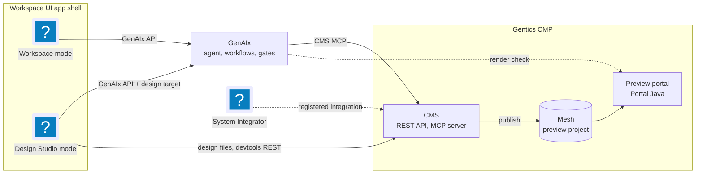
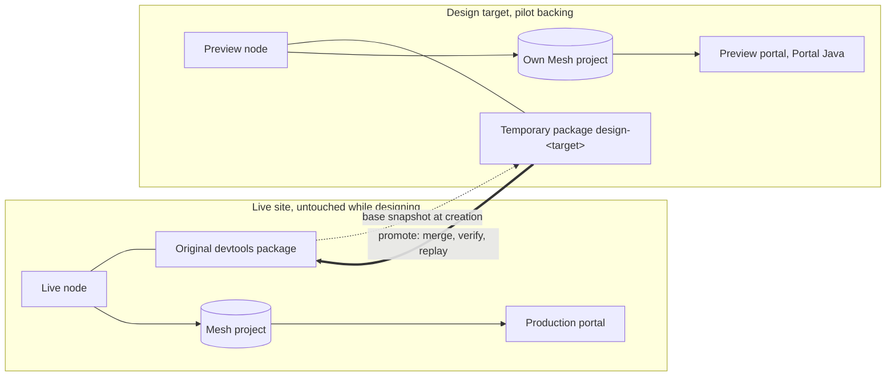

# Design Studio: architecture

This document starts the Design Studio section of the handout (documents 10 to 15, since
`1.0.0-rc.7`, a draft for the pilot that starts with CMP 9.0). It says what the Design Studio is
from GenAIx's side, how it connects to the CMS, Mesh and the portals, how a design is kept apart
from the live site while it is worked on, and who builds which part. Read `01-architecture.md` and
`03-genaix-api.md` first: the Design Studio uses the same API, sessions, plans, events and
interactions as the Workspace, and this section adds only what is new.

| # | Document | Covers |
|---|---|---|
| 10 | `10-design-studio.md` | This architecture: the mode in the shell, the design target, the pilot setup, who builds what |
| 11 | `11-design-studio-use-cases.md` | The use cases as API call and event sequences, and the pilot's acceptance scenarios |
| 12 | `12-design-studio-files.md` | Where a design lives: the design files and their metadata in the CMS, revisions, concurrent edits |
| 13 | `13-design-studio-verification.md` | How GenAIx checks a revision by rendering it: viewports, verdicts, fonts |
| 14 | `14-design-studio-promotion.md` | How an approved design reaches the live node: base, git merge, verification, replay |
| 15 | `15-design-studio-cms-and-si.md` | The CMS MCP tools this needs, and what a System Integrator's integration must declare |

## 1. What the Design Studio is

The Design Studio is a no-code tool for Template Designers: it turns sources (the URL of an
existing site, a ZIP of finished templates, or a briefing with screenshots) into the templates,
constructs and portal templates of a Gentics CMP site. GenAIx does the design work: it builds the
template set, decomposes it into CMS elements, verifies the result by rendering it and, once the
designer approves, carries it over to the live site.

Five decisions shape everything in this section:

1. **A mode of the Workspace UI, not a second application.** The Design Studio and the Workspace
   are two views of one application shell, switched by permission. Both use the GenAIx API as it
   is; a session with a design target is a Design Studio session (§3).
2. **Work happens on a design target.** Like a git worktree: a copy of the site's implementation
   to work on, merged back when approved. GenAIx refuses every write outside the target with its
   own gate, whatever the model asks for.
3. **The CMS holds the design.** The design files and their metadata live in a devtools package of
   the target, read and written through the CMS REST API by both the Design Studio UI and GenAIx
   (`12-design-studio-files.md`). Devtools package synchronisation is never used.
4. **Checked by rendering.** GenAIx renders the target through a preview portal and compares it
   with the design (`13-design-studio-verification.md`).
5. **Promotion is a merge.** An approved design is merged with what changed on the live site since
   the target was created, verified again, and replayed onto the live node as a reviewed plan
   (`14-design-studio-promotion.md`).

The Design Studio never implements system integrations. A region whose data comes from an
external system is mapped to an integration a System Integrator built in code
(`15-design-studio-cms-and-si.md` §2).

## 2. Components



The UI renders and edits the design files in the CMS directly. Everything the agent does goes
through the GenAIx API and, from GenAIx, through the CMS MCP server on the user's own credential,
as in the Workspace (`02-auth-and-context-flow.md`).

### 2.1 How a CMS design reaches a rendered page today

Three mechanisms of Gentics CMP decide what a preview can show:

- **CMS to Mesh.** With "Project per Node", a master node and its channels publish into one Mesh
  project, one branch each; a ContentRepository *implementation version* creates further branches
  tagged `gcmsImplementationVersion`, and the old branch stays (Gentics guide "Mesh
  ContentRepository Implementation Branches"; `MeshPublisher.java`). Mesh can neither merge nor
  delete branches (Mesh documentation, "Content branches").
- **Constructs render in the CMS.** A construct (tag type) is global and is rendered inside the
  CMS; Mesh receives the rendered tag content. Changing a construct changes every page that uses
  it at the next publish, on every branch. Templates and constructs keep no version history; only
  pages and forms do.
- **Portal implementations as CMS objects.** A portal implementation holds a portal's templates,
  queries, translations and static files, is assigned to nodes, and is published to Mesh as one
  ZIP node at the project root by the regular publish run. A Portal Java instance loads one by its
  keyword (`portalImplementation`) from the project's default branch and reloads it when it
  changes. This is on the unreleased cms-oss branch `f-gpu-2770`; the portal loaders are
  documented there for Java (`admin_portal_implementations.textile`).
- **CMS preview.** The CMS renders a page from its current saved state and POSTs it to the master
  node's Mesh Preview URL (`/api/preview` on Portal Java); navigation and other pages come from the
  published Mesh data (`RenderUtils.java`; Portal Java "Preview handling"). The preview URL is set
  per master node.

## 3. The design target

A design target is where a design is worked on until it is approved. The contract names it
`SessionContext.design_target` (`03-genaix-api.md`, `openapi.yaml`), so a client never needs to
know how it is backed:

| Field | Meaning |
|---|---|
| `target_id` | The target's identifier, obtained by the UI from the CMS side |
| `node_id` | The CMS node GenAIx writes to while designing |
| `package` | The target's temporary devtools package, which holds its design files and its constructs and templates |
| `source_node_id` | The live node the design is promoted to |
| `promotion_mode` | `replay` while the CMS cannot merge (the pilot), `merge` once it can |

The UI sends the target when it creates the session. GenAIx pins it to the session, refuses to
change it afterwards (`409 design_target_immutable`), and its tool gate refuses every CMS write of
the session's runs that addresses an object outside the target. A refused write is a tool error
inside the run, never a failed run.

The target's objects are the ones created in it: its node, its package, and the constructs,
templates and portal implementations a design run created or copied there. An object the target
shares with the live site, such as a construct assigned to both nodes, may be read and used by the
design but never changed (§3.3). The one exception is promotion: an **accepted** `design_promote`
plan may write the live objects its items name, and nothing else
(`14-design-studio-promotion.md` §5). The plan's scope, not the target, bounds those writes.

### 3.1 The pilot: a preview node until the CMS has branches



Until the CMS has native branches, the pilot backs a target with:

- a **preview node** of its own, so the live node's preview URL, its Mesh branches and the portal
  implementation its production portal loads stay untouched;
- a **temporary devtools package** assigned to that node, holding the target's constructs and
  templates (added through the package REST API) and its design files;
- its **own Mesh project** on the existing Mesh instance;
- a **private Portal Java instance** configured at deployment for that project.

A new branch inside the live node's Mesh project was rejected for the pilot: the preview URL is
per master node, the portal implementation loader reads the project's default branch, and Mesh
branches cannot be removed. The target is set up on the CMS side, by the UI or an administrator;
GenAIx receives it and never creates or deletes nodes, packages or Mesh projects. After a
successful promotion the temporary package is deleted; an unpromoted target stays until a user
deletes it, since it is the user's work.

### 3.3 Shared objects are copied before they change

A preview node does not copy what makes the site's implementation: constructs are global and a
node copy keeps using the same constructs, and adding an object to a package keeps its identity. So
a design that wants to change an existing construct, template or portal implementation first
**copies** it into the target under a new keyword and a new global ID, points the target's templates
and pages at the copy, and changes only the copy. Every copy is recorded in the target's identity
map, `files-private/design/identity.json`:

```json
{ "copies": [
  { "type": "construct", "original_global_id": "A547.75412", "copy_global_id": "A547.80911",
    "original_keyword": "teaser", "copy_keyword": "teaser_design_umdasch" }
] }
```

Objects the design only uses, unchanged, stay shared. Promotion maps each copy back to its
original and writes the merged result into the **original** object, never the copy, so the live
site keeps its keywords and global IDs (`14-design-studio-promotion.md` §3).

### 3.2 The target model with CMS branches

The 19 Nov meeting planned branches in the CMS: the Design Studio asks the CMS for a named
branch, works on it (constructs, templates, portal implementations, content), the branch
publishes to a Mesh branch that a preview portal renders, and the CMS merges it back to the main
line when the designer approves. Branches stay until a user deletes them. When that exists, a
target's backing becomes a branch and `promotion_mode` becomes `merge`; the session, revision and
event shapes of this section stay the same. Gentics defines it (§5, G9).

## 4. Who builds what

| Who | Builds |
|---|---|
| Design Studio UI (Gentics) | The mode in the shell; rendering revisions from the CMS; visual editing, region comments and approval; setting up and deleting design targets; creating CMS tasks the agent hands over, such as "request a construct" (`03-genaix-api.md` §9.2) |
| GenAIx (ioflair) | Sources to templates; decomposition into CMS elements; the target's write scope; render verification and the font report; the merge and replay of a promotion; this handout |
| CMS core (Gentics) | For the pilot: the package file API with a private storage (§5, G1 to G3) and portal implementations as CMS objects. Later: native branches with revisions, reference resolution, conflict detection, merge and republishing |
| CMS MCP server (ioflair builds, on a cms-oss branch) | The tools in `15-design-studio-cms-and-si.md` §1, as ioflair builds the Phase Two tools; Gentics reviews and merges them into the CMS |
| Portals (Gentics) | Once: loading the right portal implementation for a preview instance, and saying which revision it serves. Otherwise deployment configuration |
| System Integrator | Integrations with external systems, in the project repository, against the Integration Kit of the CMP version. GenAIx maps a region to a registered integration and never implements one |

## 5. Gentics TODO

What the Gentics CMS team does for the Design Studio. The numbers are used across this section.

| # | TODO | Why the Design Studio needs it |
|---|---|---|
| G1 | **Add a private file storage to devtools packages.** A third storage beside `files` and `files-internal`, for example `files-private`, that the package file API lists, reads, uploads and deletes like the other two, under the same rights, and that **no URL serves statically**. | Design files are a customer's unpublished site. `files` (`/static/…`) and `files-internal` (`/internal/…`) are both served without a login (verified on CMS 6.5, 2026-11-24), so neither may hold them (`12-design-studio-files.md` §1, §6) |
| G2 | **Keep the served package URLs inside their folder.** The URLs that serve `files` and `files-internal` only ever resolve to a file inside that folder; dot segments and any other path that resolves elsewhere in a package are refused. Details go to the CMS team separately. | Otherwise every folder of a package, a private one included, is readable without a login |
| G3 | **Add a conditional write to the package file API.** An upload that succeeds only if the file is unchanged (`If-Match` on an ETag) or does not exist yet. | Two writers, the UI and GenAIx, can otherwise overwrite the revision pointer (`12-design-studio-files.md` §4) |
| G4 | **Provide a way to start a design node's publish run and to read when it has finished**, for `get_node_publish_status`. | Portal implementations reach Mesh only by a regular publish run (`15-design-studio-cms-and-si.md` §1) |
| G5 | **Release portal implementations (GPU-2770)**: merge `f-gpu-2770`, publish the Java and PHP loader code, and state whether a portal can load an implementation from a chosen Mesh branch. | The preview portal loads the design's templates from them (§2.1) |
| G6 | **Ship the package file API (GPU-2677) in CMP 9.0**, together with G1 to G3. | All design files go through it (`12-design-studio-files.md` §1) |
| G7 | **Make the Mesh Preview URL settable per node copy or per request.** | Today it is set per master node, so a design preview cannot run beside the live preview of the same node (§2.1) |
| G8 | **Name the endpoint that lists the pages using a template**, for `get_template_usage`. | `GET /template/{id}/tagstatus` returns counts per template tag, not pages; a promotion plan lists the affected pages (`14-design-studio-promotion.md` §5) |
| G9 | **Define native CMS branches**: what a branch covers (constructs, templates, portal implementations, content), how its merge reports conflicts, who may delete it, and how devtools packages relate to it. | The target model after the pilot (§3.2) |
| G10 | **Define the integration object in the CMS** and how it is listed and read, with the contents of `15-design-studio-cms-and-si.md` §2. | GenAIx maps integration blocks to registered integrations |

Until G1 and G2 ship, the pilot keeps the design files under `files-internal/design/` and stores only
designs of non-confidential sites there.
