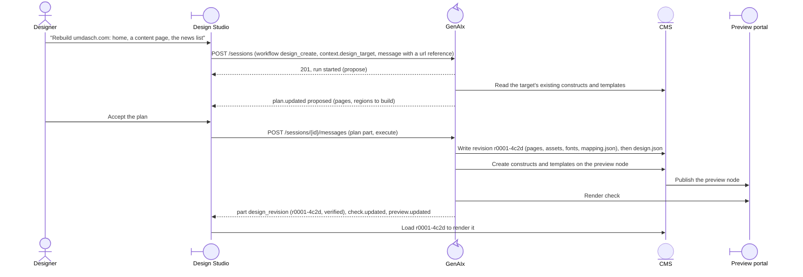

# Design Studio: use cases

Each use case below is a sequence of GenAIx API calls and the events a client sees, using only
routes and events of `openapi.yaml` (since `1.0.0-rc.7`). The new shapes are
`SessionContext.design_target`, the `design_revision` part, the `design_revision` and
`design_region` reference types and the optional `revision_id` on `preview.updated`
(`10-design-studio.md` §3, `03-genaix-api.md`). Two workflow modules carry the work:
`design_create` (sources to an approved revision) and `design_promote` (an approved revision to
the live node). Both are listed in `GET /workflows` only for users with template rights.

What does not change: a message starts a run; a plan is proposed, accepted by the user's own
message, executed and gated (`03-genaix-api.md` §4, §5.3); questions are interactions (§9); the
stream is replayable (§6.1).

## 1. Import from the URL of an existing site

The designer names a site; GenAIx captures it and builds the first revision on the target.

1. `POST /sessions` with `workflow: "design_create"`, `context.design_target` and a first message
   whose parts are a `text` part (what to build) and a `reference` part of type `url`. A session
   without a design target for a design module is `422 design_target_required`.
2. The proposing run reads the site and the target, then `plan.updated` with `status: proposed`:
   one item per page template and per new construct, kinds `template` and `construct`.
3. The designer accepts with a `plan` part on an `execute` message (`03-genaix-api.md` §5.3).
4. The execute run writes the revision into the target's package (`12-design-studio-files.md`),
   creates the constructs and templates on the preview node, publishes it and runs the render
   check (`13-design-studio-verification.md`).
5. The run emits a `design_revision` part (`status: verified` or `draft` when the check failed),
   `check.updated` for each finding and `preview.updated` with `revision_id` for each page.
6. The UI renders the revision from the CMS, not from GenAIx.

What GenAIx captures from the URL: the HTML of the named pages after the browser has run them,
the stylesheets, images and the web fonts the pages load. A font the page requests but cannot
load is reported, never replaced silently.

## 2. Import from a ZIP of finished templates (design lock)

As §1, with the source uploaded first:

1. `POST /sessions/{id}/files` with the ZIP (`mode: source`), then a message whose parts are a
   `text` part and a `file_ref` part naming it. For a new session the two-call flow applies
   (`03-genaix-api.md` §10).
2. The first revision keeps the imported HTML, CSS, JavaScript and assets **byte-identical** and
   records their hashes in `mapping.json` (`locked_files`). Region identifiers go into the mapping,
   never into the locked files (`12-design-studio-files.md` §3).
3. A later revision that would change a locked file is not written; the run reports it as a
   finding and asks the designer.

## 3. Design from a briefing and screenshots

As §1, with `text` parts for the briefing and `file_ref` parts for uploaded screenshots
(`mode: source`). GenAIx builds the template set from them; screenshots are inputs and advisory
references for the vision review, never a pixel baseline (`13-design-studio-verification.md` §4).

## 4. Correct a mapping or comment on a region

The designer sees a region proposed as a new construct and wants an existing one instead, or
comments on a region.

- **A comment** is a message: a `text` part and a `reference` part of type `design_region`
  (`id`: the region id, `label`: what the designer sees). Add a `design_revision` reference to say
  which revision the comment is about; without it the current one is meant.
- **A mapping correction** GenAIx asks for itself: a `form` interaction whose fields are reference
  fields of type `construct` or `template` (`03-genaix-api.md` §9, rc.6), or a `choice` with
  `reference_types` when it offers candidates.
- **An edit in the Design Studio's own editor** writes a new revision directly in the CMS
  (`12-design-studio-files.md` §4) and tells GenAIx with a message naming it as a
  `design_revision` reference.

Every correction produces a new revision with `previous_revision_id`; earlier revisions stay
readable. A run that started from a revision that is no longer current does not move the pointer
(`409 design_revision_conflict` for a client's own request, a finding inside a run) and rebuilds on
top of the current one.

## 5. Verify a revision

GenAIx runs the render check itself after every revision it writes, as a blocking `script` gate at
`step_end` of the build step, and again `before_release`. A designer who edited a revision in the UI
asks for a check with a message; the run checks the current revision. Results arrive as
`check.updated` with the report in the revision's `evidence/` directory (`report.json`,
`screenshots/`). The
verdicts are in `13-design-studio-verification.md` §3.

## 6. Approve

Approving is the plan's `release` transition: `POST /sessions/{id}/plans/{plan_id}/transitions`
with `release`, which runs the `before_release` gates, the render check among them
(`03-genaix-api.md` §4.2). `409 quality_gate_failed` lists what blocks it. A released plan's
revision gets `status: approved` on a new `design_revision` part. Approval never changes the live
node.

## 7. Promote by merge and replay

1. The designer starts a new message in the same session: "promote revision r0004-7f3a". The session
   agent drafts a plan with `design_promote`.
2. The proposing run merges the approved revision's snapshot with the live package against the
   target's base, reading only (`14-design-studio-promotion.md` §3). Conflicts it may not resolve
   become `choice` interactions.
3. `plan.updated` proposes a first item that writes the merged result to the target and checks it,
   then one item per live object change, with every automatic resolution in the item's `detail`, and
   the pages that use a changed construct or template.
4. The designer accepts. The execute run writes the merged result to the target and runs the render
   check; only when it passes does it replay the changes onto the live node through the CMS MCP
   tools, in the order constructs, templates, portal implementations. A live object changed since
   the merge stops its item and that object is merged again.
5. The `design_revision` part ends with `status: promoted`. The UI deletes the temporary package.

`promotion_mode: merge` (native CMS branches) replaces steps 2 to 4 with the CMS's own merge; the
calls the client makes stay the same.

## 8. Acceptance scenarios for the pilot

The pilot's first site is the Umdasch Group website: main navigation, German and English, footer
navigation, cookie settings, no search and no login. A scenario is accepted when every listed
outcome holds on the pilot environment with the real model, the CMS, the preview portal and the
Design Studio UI.

| # | Scenario | Accepted when | Use case | Check |
|---|---|---|---|---|
| A1 | Import the home page, one content page and the news list from the live site's URL | One revision with all three pages in DE and EN; header, footer and main navigation mapped once and shared; every region mapped; the render check passes or names each difference | §1 | `13` §3 |
| A2 | Import a ZIP of the same pages as finished templates | Imported files unchanged (hashes recorded); a change to a locked file is refused and reported; the render check compares pixel by pixel with zero differences outside agreed masks | §2 | `13` §3, locked |
| A3 | Design a campaign page from a briefing and two screenshots | One revision that follows the briefing; existing constructs reused where they fit; screenshots used only by the advisory review | §3 | `13` §4 |
| A4 | Correct one mapping and comment on one region | The correction and the comment each produce a new revision; region ids unchanged; the earlier revision still readable | §4 | `12` §4 |
| A5 | Fonts | Every key region reports the requested and the drawn font; a missing licensed web font is a finding, never a silent substitute | §5 | `13` §5 |
| A6 | Approve | `release` passes the render check; the live node is unchanged | §6 | `13` §3 |
| A7 | Promote while the live site changed a construct the design also changed | The textual conflict is resolved with a reason or asked; the merged result passes the check on the target; the replay writes only through the CMS tools; the live pages render | §7 | `14` §3 |
| A8 | Write outside the target | A write the model attempts on the live node during design is refused by GenAIx's gate and never reaches the CMS | §1 | `10` §3 |
