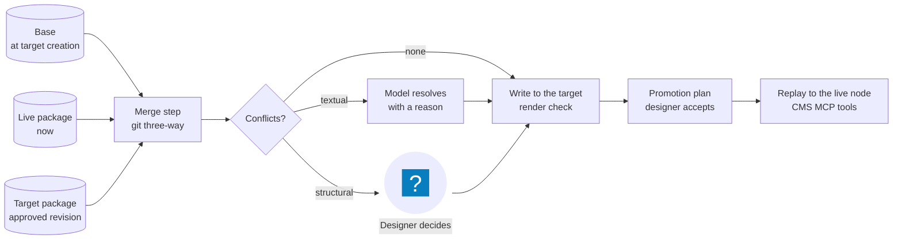

# Design Studio: promotion

An approved revision lives on the design target. Promotion carries it to the live node. Until the
CMS can merge branches (`promotion_mode: replay`), GenAIx does it: a git three-way merge against a
base recorded when the target was created, a render check of the merged result on the target, and
a replay onto the live node as a plan the designer accepts. When the CMS can merge
(`promotion_mode: merge`), its merge replaces this; the calls a client makes stay the same
(`11-design-studio-use-cases.md` §7).

## 1. What is promoted

The objects the **approved revision** created or changed, as its `implementation/` snapshot froze
them (`12-design-studio-files.md` §2), never the target's objects as they are later: constructs (with
their parts and templates), page templates (source, template tags, folder links), portal
implementation files, and the templates' companion metadata (`12-design-studio-files.md` §5).
Content pages are not promoted; the target's pages exist to show the design.

## 2. The base

When a target is created, GenAIx reads the original package's objects through the package REST API
and stores them in the target's package as `files-private/design/base/`, one file per object in a
fixed form so that line-based merging is meaningful:

- JSON with sorted keys, one property per line, keyed by the object's global ID;
- a template's source and each construct part's template as a separate text file beside it.

A revision's `implementation/` snapshot uses the same form. A copy of a shared object
(`10-design-studio.md` §3.3) is stored there under its **original's** global ID, translated through
`identity.json`, so the three trees line up object by object. The base lives in the CMS, so any later
run can rebuild the merge from it.

## 3. The merge

Promotion is the workflow module `design_promote`. Its merge step runs a script shipped with the
module, started by the GenAIx harness in the run sandbox, the way a script gate runs today
(`08-workflow-modules.md` §7.1):

1. The script reads the base, the live package as it is now and the approved revision's
   `implementation/` snapshot, with read-only CMS access.
2. It writes the three into a scratch git repository in the run's own directory as three commits
   (base, then live and the revision as two branches from it) and runs `git merge`.
3. It writes the merged tree and the list of conflicts into the run's files.

The merge runs in the plan's **proposing** run, which writes nothing to the CMS: the script only
reads, and its result stays in the run's files. Conflicts left to the designer are asked in that run,
so the proposed plan already shows every resolution.

The model resolves only the listed textual conflicts, each with a recorded reason. These are never
resolved automatically and go to the designer as a `choice`:

- a construct part the revision removes that pages on the live node still fill;
- a global ID the revision renames or removes;
- a construct that other nodes use too, since its change reaches their pages.

## 4. Verify before live

A proposing run cannot write, so the merged result is verified after the designer accepts the plan,
and before any live write. The plan's first item writes the merged result to the design target, as
a new revision, and its `step_end` render check (`13-design-studio-verification.md`) is blocking. The
live items depend on it (`depends_on`), so a bad resolution stops the run on the preview, never on the
live node; the designer then revises the plan.

## 5. Replay

The promotion plan lists the verification item of §4, then one item per object change (`kind`
`construct`, `template` or `portal_implementation`, its `target` naming the live object), each
automatic resolution in the item's `detail`, and the live pages that use a changed construct or
template. Nothing is written to the live node before the designer accepts it.

An accepted `design_promote` plan is the one exception to the design target's write scope
(`10-design-studio.md` §3): its run may write exactly the live objects its items name, into the live
node and its original package, and GenAIx's gate refuses anything else. Each copy is written back
into its original object, under the original keyword and global ID; the copies stay in the temporary
package and go with it.

The execute run writes through the CMS MCP tools in dependency order: constructs, then templates,
then portal implementations, then the companion metadata. Before each write it compares the live
object with the version it merged against; if the object changed since, that item stops and the
object is merged again. Devtools package synchronisation is not used: each object is written by its
own call (`15-design-studio-cms-and-si.md` §1).

The plan's `before_release` and `before_publish` gates run as for any plan. After a successful
promotion the `design_revision` part reports `status: promoted` and the UI deletes the temporary
package.
